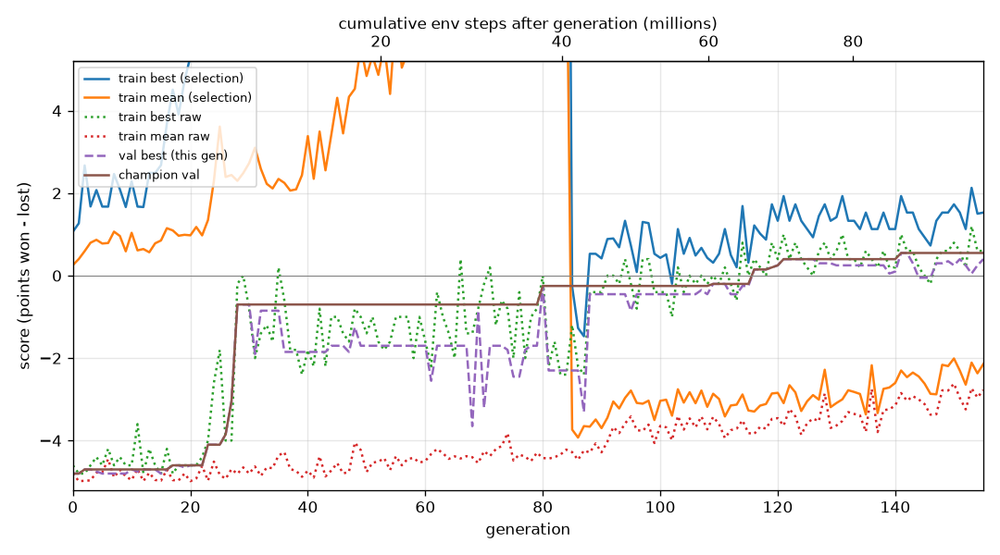

# Q1 — Slime volleyball with NEAT

**Result (3 seeds, 100 held-out episodes each):** every seed reaches **T3 or better**.
The mean across seeds is +0.10, but with 3 seeds its 95% CI is [−0.52, +0.72] (t, df = 2);
pooling all 300 episodes gives [−0.01, +0.21]. So this is *not* evidence that the
method beats the opponent on average. It is evidence that each champion reaches T3, and
that one champion beats it.

| seed | held-out mean [95% CI] | W / D / L |
|---|---|---|
| 0 | −0.16 [−0.37, +0.05] | 19 / 45 / 36 |
| 1 | **+0.34 [+0.14, +0.54]** | 39 / 45 / 16 |
| 2 | +0.12 [−0.06, +0.30] | 30 / 44 / 26 |

**Bonus tier (> 0) reached.** I committed a headline rule before these runs: pick the
best *validation* score. Seeds 1 and 2 tie on it at +0.55. I don't break the tie with
held-out data, and the claim doesn't need me to: both tied champions are above 0
held-out. Only seed 1 is significantly above 0 (p = 0.001); seed 2 is above 0 in mean
only (p = 0.20). Seed 1 beats seed 0 (paired p = 0.001) but not seed 2 (p = 0.11).

Getting here took a change to how outputs become actions, plus `response` 1.0 (*How
the replication was fixed*). With the original mapping, the identical command escaped the net-camper trap
on **1 of 3** seeds (−0.37 / −4.77 / −4.79).

Every number here is re-derivable from `runs/<id>/` (schema in [LOGS.md](LOGS.md));
`analyze_run.py` recomputes them all (0 FAIL on every full run). The commit history is
the lab notebook.

## Pipeline

- **`episode.py`** — `play_episode(net, env)` (signature unchanged):
  - resets the built-in opponent's RNN every episode (*What went wrong* #1)
  - maps outputs to actions through `action_from_outputs`, using the mapping the run's
    config declares
  - **`direction`** (used for the headline): 2 sigmoid outputs. One sets movement:
    above 2/3 forward, below 1/3 backward, otherwise stay. The other jumps when above
    0.5.
  - **`threshold`** (original): 3 outputs, each button pressed when above 0.5.
  - `run_episode` records points, ball contacts, returns, movement, jumps and court
    zone for every episode.
- **`evolve.py`** — fitness is the mean over 5 seeded games, shared by the whole
  generation and fresh each generation.
  - The **champion is picked on 20 fixed validation seeds**, never on training fitness.
  - Seed ranges are disjoint: train `[0, 1e6)`, held-out `[1e6, 2e6)`, validation
    `2e6+`, probes `3e6+`.
  - Snapshots every 10M steps.
  - Stops at a generation boundary within budget.
  - Any crash is recorded in the run directory.
- **Curriculum** (`--phase1-steps 40M`) — selection fitness per game is
  `returns + 0.3·steps/3000` until 40M steps, with no score term. After that it is
  `score + 0.3·steps/3000 + 0.07·min(returns, 9)`. Shaping is capped below one point
  *per game* (B + R·cap = 0.93 < 1). Fitness is a 5-game mean, so there one extra point
  is worth only 0.2. Shaping reorders about 2% of phase-2 genome pairs against their raw
  means; it barely matters because the champion is chosen on raw validation score.
- **Configs** — `configs/direction_r1.ini` differs from the original shipped
  `neat_config.ini` (first commit) only in:
  - 2 derived inputs (`ball x − my x`, `ball y − my y`)
  - sigmoid-only nodes
  - lower delete probabilities
  - `compatibility_threshold 2.0`
  - 2 outputs with `[Action] mapping = direction`

  The `[Action]` section is our own; neat ignores it, `evolve.load_config` reads it,
  and `make_net` attaches it to the network. Response stays at 1.0, the shipped value.
  `neat_config.ini` itself was changed early on (`dc6408d`: sigmoid-only,
  compatibility 2.0) but keeps 12 inputs and 3 outputs, which `sanity_check.sh` asserts.
- **Tools:**
  - `evaluate.py` — t interval and bootstrap interval
  - `analyze_run.py`
  - `reward_check.py` — ranks fixed policies under every fitness formula
  - `mapping_check.py`
  - `replay.py` / `replay_snapshots.py` — HUD, cross-checked against the logs
  - `architecture.py`, `behavior.py`
  - `pipeline_test.py`
  - `experiments/` — the hypothesis, mapping and replication scripts

**Reproduce** (conda env `astra`, Python 3.11; ~25 min on 9 cores; seeds 0, 1, 2):

```sh
python evolve.py --seed 1 --config configs/direction_r1.ini --workers 3 \
  --phase1-steps 40000000 --phase1-survival 0.3 \
  --survival-bonus 0.3 --return-bonus 0.07 --return-cap 9 --run-id full100m_direction_s1
python evaluate.py --winner runs/full100m_direction_s1/champion.pkl --episodes 100
```

This is the recorded command (`runs/full100m_direction_s1/run_args.json`).
`experiments/full_direction.sh` runs all three seeds plus evaluation and replays. The
same command reproduces byte-identical `genomes.jsonl`, `validation.jsonl` and champion,
whether run with 3 or 9 workers.

## Fitness curve



*Best run (seed 1): population best and mean per generation, from
`runs/full100m_direction_s1/fitness_history.csv`. Dotted lines are raw score (points
won − lost, the graded scale): population best (green) and mean (red). Solid lines are
the selection fitness the population was ranked on. Until 40M steps (generation 85
here) that is the phase-1 objective (returns + survival, no score term), which is on a
different scale and runs off the top of the plot. After the switch it is score plus
capped shaping, so it sits at most 0.93 above the raw lines. Dashed purple: validation score
of this generation's best genome; brown: the champion's validation score. Seeds 0 and
2: `runs/full100m_direction_s{0,2}/analysis/fitness_curve.png`.*


*Champion validation score against steps, all three seeds, same fitness formula; only
the action mapping and `response` (0.2 → 1.0) differ.*
- **Direction mapping:** every seed escapes −4.7 between 7M and 12M steps. Seeds 0 and
  2 reach 0 by 20M, *before score is part of fitness*. All three end at +0.45 to +0.55.
- **Old mapping:** seed 0 escapes later (~17M); seeds 1 and 2 stay net campers for the
  whole budget.

From the per-run curves:
- The population **mean** raw score lags far behind the best. After 80M steps it
  averages −3.08 / −3.10 / −2.58 while the champions sit near 0, because mutation
  breaks many offspring of good genomes. (In the old, stuck runs it stayed near −4.5.)
- Two confounds are measured each run:
  - **Seed difficulty.** Within a phase, it explains r² = 0.17 / 0.01 / 0.26 (phase 1)
    and 0.34 / 0.06 / 0.17 (phase 2) of generation-to-generation movement in
    training-best. That is an association, measured on elites re-scored on new seeds.
    The generation where the phase switches is excluded; an earlier version of the
    analyzer included it, and that single point inflated the figure to "72–83%" (*What
    went wrong* #11).
  - **Winner's curse.** For validated genomes in phase 2, where every champion came
    from, training raw score overstates validation by +0.30 / +0.29 / +0.38 (95% CIs
    within ±0.07). In phase 1, where selection isn't on score, the gap is only
    +0.04 to +0.13.
  - Both are why only held-out numbers are reported.

## Champion evaluation

| | seed 0 | seed 1 | seed 2 | old mapping (s0/s1/s2) | old mapping, no curriculum |
|---|---|---|---|---|---|
| held-out mean | −0.160 | **+0.340** | +0.120 | −0.37 / −4.77 / −4.79 | −4.78 |
| 95% CI (t) | [−0.365, +0.045] | [+0.140, +0.540] | [−0.063, +0.303] | | [−4.87, −4.69] |
| 95% CI (bootstrap) | [−0.350, +0.050] | [+0.140, +0.540] | [−0.060, +0.300] | | |
| W / D / L | 19/45/36 | 39/45/16 | 30/44/26 | | 0/0/100 |
| points won / lost | 39/55 | 63/29 | 46/34 | | 22/500 |
| tier | T3 | bonus (CI > 0) | bonus (mean > 0) | T3 / T1 / T1 | T1 |

Every game reaches the 3000-step limit, which is normal for competent play here (see
*Behavior*).

## Champion architecture

| champion | nodes (outputs + hidden) | enabled connections | effective nodes / connections | activations |
|---|---|---|---|---|
| seed 0 | 6 (2 + 4) | 10 (16 disabled) | 6 / 10 | sigmoid × 6 |
| seed 1 | 4 (2 + 2) | 19 (13 disabled) | 4 / 19 | sigmoid × 4 |
| seed 2 | 4 (2 + 2) | 16 (11 disabled) | 4 / 16 | sigmoid × 4 |

Each champion has 14 inputs: the 12 observations plus the 2 derived `ball − me`
inputs. Node counts above exclude inputs, as neat-python does; seeds 0 / 1 / 2 use 5 /
12 / 11 of the 14 inputs on a path to an output. All are feed-forward, sum aggregation,
response 1.0. Tables: `runs/full100m_direction_s*/architecture.md`.

- **All three found the same core:** `direction ← (ball x − my x)` with weight
  −8.1 / −11.5 / −11.4, meaning *move toward the ball's x*. That's the one-weight
  tracker `mapping_check.py` predicted.
- **Seed 1 also learned jump timing:** its jump output is driven mainly by the ball's
  vertical velocity (−5.2), and it jumps on 44% of steps. Seed 0 jumps on 99%.

## Behavioral analysis

Seed 1's replays at 10M → 60M → final (`runs/full100m_direction_s1/snapshots/replays/`)
show the progression net camper → chasing → rallying. Where the table rows come from:
- possession and longest hold: `behavior.py`, 20 held-out games
- contacts, returns, distance, zones and jumping: `evaluate.py`, all 100 held-out games
- built-in policy column: its own network playing our seat (`behavior.py` /
  `reward_check.py`)

| | seed 0 | seed 1 | seed 2 | built-in policy (our seat) |
|---|---|---|---|---|
| ball on our half | 55% | 56% | 67% | 49% |
| longest hold, mean / max (steps) | 143 / 184 | 126 / 154 | 334 / 498 | 185 / 292 |
| contacts / returns per game | 64 / 25.5 | 64 / 26.1 | 81 / 15.8 | 45 / 24 |
| distance moved per game | 612 | 706 | 913 | ~555 |
| time at the net / mid / back | 75 / 17 / 8% | 76 / 17 / 7% | 54 / 21 / 25% | |
| jump pressed | 99% of steps | 44% | 74% | |

- **Strategy:** all three track the ball's x along their whole half and play it back.
  - Points are won by forcing errors: the opponent touched last.
  - Points are lost mostly to their own touch dropping short in front of them (seeds
    0 and 1).
  - Seed 2 loses more balls behind it but holds possession longer.
- **Exploit-like behaviour, checked rather than assumed:**
  - `analyze_run`'s juggling detector fires at *population* level. Many genomes touch
    the ball often and rarely return it, which is plausibly the survival term rewarding
    keeping the ball alive.
  - The champions are filtered by raw validation score. Seeds 0 and 1 hold the ball
    *less* than the built-in policy, and seed 2 holds it longer (max 498 steps), but
    nowhere near clock-running.
  - Timeouts are not a stalling signal: the built-in policy playing against itself
    reaches the 3000-step limit in 20 of 20 games.
- **Constant jumping** (seed 0, and the old T3 champion) is not required for good play.
  Seed 1, the best scorer, jumps on 44% of steps.
- **Earlier finding** (old T3 champion): 42% of its lost points came in the first 300
  steps of a game, so openings were its weak spot.
- **What shaping did:**
  - Survival-only shaping separated a ball-tracker from a net camper by 0.06, inside
    the noise.
  - The phase-1 objective separates them by 2.4.
  - **But returns stop distinguishing champions at the top.** On held-out games,
    seed 2 scores higher than seed 0 (+0.28, paired p = 0.03) with 38% fewer returns
    (15.8 vs 25.5). So "more returns" no longer means "more points" once agents can
    rally, which is why selection hands over to score.
  - `reward_check`'s ordering test still passes the phase-1 formula at 20, 50 and 100
    probe games. A 10-game run had flagged it, but at that size the raw-score gaps
    were within noise, and it was over-read at first (*What went wrong* #10).
  - All three champions were selected in phase 2 (generations 99 / 141 / 128; the
    switch was at ~82).

## What went wrong, and how I found it

**How I worked.** I used Claude Code throughout. I reviewed the run logs and replays
myself, decided what to test, pushed back on results that looked wrong or too
convenient, and asked for independent audits before trusting the big numbers.

1. **The opponent remembered the previous game.** Calling
   `env.reset()` did not reset the built-in opponent's memory (it is a recurrent
   network), so the same seed could give a different game: seed 7 played twice gave
   2903 steps, then 1194. We caught this while adding seeding and fixed it in
   `play_episode`. A few minutes later, an independent audit that I had asked for (to
   look for anything that could give us misleading results) confirmed it: 30
   of 30 replays went a different way from the very first step. Now a replay matches a
   fresh environment exactly.
2. **The champion was just the luckiest score, and the fitness curve partly measured
   how easy the seeds were.** *Found by the audit I asked for.* The original
   driver kept whichever genome had the highest training score ever seen. With only 5
   noisy games per genome, that mostly picks luck. Training score overstates validation
   score by about +0.3 in the phase where champions are picked (*Fitness curve*), and
   validation overstates held-out too: the baseline's −4.55 on validation became −4.78
   on held-out games. I then asked to see the exact math and to check for statistical
   biases, which added the winner's-curse check to `analyze_run.py`. Fix: pick the
   champion on fixed validation seeds, plot a validation line on the curve, and report
   only held-out numbers.
3. **Five runs learned nothing, and at first the logs could only show *that*, not
   *why*.** The short sample runs were my idea, to catch problems before a full run.
   They showed that nothing was learning:
   - 89% of games were 5–0 losses. In most generations, 85% or more of the genomes had
     exactly the same points, decided by the serve (the full range per generation was
     50–100%).
   - I asked whether we were logging enough to tell where a problem came from. The
     answer was no: the logs could show *that* something was wrong but not *why*, so we
     added ball-contact counting by wrapping `Particle.bounce` (games are byte-identical
     with and without the wrapper). Contacts were about 1.5–1.7 per game, close to
     random play's 1.4.
   - I asked to watch replays next to the logs. The replays showed the "net camper":
     an agent that sits at the net and never chases the ball.
   - I also questioned the plan to compare four settings with 5M-step runs ("do we
     expect to see gains after 5M steps?"). 5M steps could not answer that, so we moved
     to 20M-step tests.
4. **Was the pipeline broken, or the goal?** First, we measured that score noise
   (5-game standard error 0.15) was almost as big as the gap between a net camper and a
   ball-tracker (0.20). I picked one of the candidate fixes, relative inputs (ball
   position minus my position). It did not help. Then the logs showed a generation-0
   champion that went unbeaten for 83 generations. To tell a broken pipeline from a bad
   goal, we wrote `pipeline_test.py`, which runs the same
   `evolve.py` but rewards ball contacts instead of score. Contacts went from 1.57 to
   3.10, so the pipeline works. The problem was the score goal, and that led to the
   curriculum. Around the same time I pointed out from the replays that the agents
   jumped a lot and touched the ball but did not move to it, so we added movement and
   jump-timing logs.
5. **We nearly introduced a reward hack.** I warned that any new reward shaping must
   not open up reward hacking. Checking for that right away showed that our own new
   return bonus had no cap, so a
   0–0 rally to the time limit could earn more than a quick 5–0 win. No run had
   exploited it yet (the most returns in any game was 7). Fixed with a cap of 9 and a
   rule that shaping in one game must stay below one point (`B + R·cap < 1`).
   `reward_check.py` checks every formula against this.
6. **Budget bookkeeping.**
   - The audit I asked for found that the original "stop at a generation boundary" check could
     never fire (7 × ⌊100M/7⌋ < 100M). So runs ended in the middle of a generation and
     threw that generation away. On a 5M-step sample run this wasted 5.35% of the
     budget; for a 100M run the audit estimated about 1%.
   - Our first fix then stopped runs too early, at 81–90% of the budget,
     because validation jobs piled onto 3 workers.
   - Running one episode per job fixed it: same results, worker imbalance fell from 11%
     to 1.3%, and runs used 97–99% of the budget. `budget.py` was never edited.
7. **Smaller bugs, each caught by a test.**
   - a fixed t = 1.984 for 20-episode confidence intervals (it should be 2.093), found
     while testing
   - the relative-input change crashing the hand-written test policies
   - snapshot labels colliding, and the 20M snapshot being skipped (the skip showed up
     when I asked to see the 10M and 20M replays)
   - replays cut off at 1400 steps, found by the audit
8. **A run died silently.** One run stopped short with no
   end time. `evolve.py` only caught budget stops, and the script threw away error
   messages (stderr went to `/dev/null`). Rerunning with error messages kept showed
   neat's `RuntimeError` (33 species × 2 > population 64). Crashes are now recorded
   and outputs are still written, and the rerun was byte-identical with 3 or 9
   workers. One side effect was caught later: while reproducing the crash, we had
   moved the crashed run's original logs, including its budget log, out of the
   repo. My rule-compliance check (item 12) found this, and the logs were put back.
9. **The method worked on only 1 of 3 seeds.** *I refused to accept it.* The agent's
   plan was to write the result up as "works, but depends on
   the seed" and move on. I said we had time and should fix it across seeds. The agent
   had already decided the cause was weights that were too small and had set up a test
   of that one fix. I asked it to come up with five different hypotheses and test them
   side by side instead. The weight-size fix failed on all three seeds, and so did the
   other four. The real cause was the action mapping (*How the replication was fixed*).
10. **A 10-game check was over-read.** *Found by the math audit I asked for.* After the
    final runs the agent re-ran `reward_check` with only 10 probe games and announced a
    "new finding": that phase 1 is misaligned at the top end, with seed 0 having "the
    most returns". Before merging, I asked for an independent math audit. It found two
    mistakes:
    - The ordering test *passes* at 20, 50 and 100 games, so the 10-game failure was
      noise.
    - "Most returns" was a misreading, not noise. Even the 10-game table showed seed 1
      ahead (26.8 returns against seed 0's 25.5), and the 25.8 quoted for seed 0 was its
      phase-1 fitness, not its returns.

    What survives is the held-out observation in *Behavior*.
11. **One data point drove a whole statistic.** *Found by the math audit I asked for.* The analyzer
    said "72–83% of jitter" came from seed difficulty. That number was a ratio of
    standard deviations, not a share of variance. It also included the one generation
    where the curriculum switches from rewarding returns to rewarding score, and that
    single point drove the whole number. The analyzer now skips pairs that cross the
    switch and reports r² per phase (0.01–0.34).
12. **Final math audit and rule check.** *I asked for both.* When the agent reported 3
    of 3 seeds at T3 or better and asked to merge, I told it to first confirm that all
    the statistics and RL math checked out, and only then merge. An independent audit
    recomputed every statistical and RL claim:
    - exact t and independent bootstrap confidence intervals, which all reproduce
    - pre-registration timing: the script was committed 2 s before the runs started
    - the validation tie, seed separation, budget totals, and the action-mapping code
      path
    - the shaping bound, which holds per game only, and a bootstrap index that was off
      by one (no effect at 3 decimals)

    Items 10 and 11, the headline's missing between-seed confidence interval, and an
    outdated population-mean figure all came from this audit. All are fixed, and the
    numbers were re-checked with scipy. I also asked for a check that we had not
    touched anything the rules forbid. That found the moved logs from item 8 and added
    the disclosures in *Rule compliance*.

## How the replication was fixed

**1. The problem.** With the original mapping, the same curriculum command reached
−0.37 on seed 0 but stayed a net camper on seeds 1 and 2 (−4.77, −4.79). Before seeds
1 and 2 ran, we decided in chat to keep seed 0 as the headline either way. That
decision was first written into a committed file after those runs had started, but
before their results came in. The agent's plan was to report the method as
seed-dependent and move on; I asked to fix it instead (*What went wrong* #9).

**2. Five hypotheses, one change each** (phase 1, 15M steps, fresh seeds 10–12;
`experiments/discovery_results.md`). This was my request: the agent had already settled
on H1 and set up a test of only that one fix.

| hypothesis | change | escaped |
|---|---|---|
| control | — | 0/3 |
| H1 weights too small | init 1→3, mutation 0.5→1.0 | 0/3 |
| H2 too few genomes | population 64→192 | 0/3 |
| H3 evaluation noise | 10 games per genome | 0/3 |
| H4 deletion drift | delete probability → 0.05 | 0/3 |
| H5 lost diversity | compatibility 2.0→1.0 | 0/2 (+1 crashed, #8) |

H1's failure was the clue. It grew tracking weights as large as seed 0's champion's
(7.8–17.9) and still didn't chase.

**3. The diagnosis, by taking seed 0's champion apart** (probe seeds). After all five
hypotheses failed, the agent recommended wrapping up Q1 and merged it, calling the
escape "a rare event, roughly 1 in 20". I asked why the method kept failing on the
other seeds, and told it to keep trying as long as it stayed within the rules. We
then removed key connections from the champion to see which ones
mattered:

| variant | phase-1 fitness | contacts |
|---|---|---|
| net camper (forward + jump) | 0.66 | 0.8 |
| full champion | 18.3 | 70 |
| remove `forward ← ball vx` | **0.66** (exactly a camper) | 0.8 |
| remove tracking, keep that link | **0.06** (worse than a camper) | 0.8 |

- A camper holds forward on, so a tracking signal on *backward* just cancels it and the
  agent stands still.
- Gating forward without tracking is *worse* than camping.
- So escaping needed two simultaneous changes, neither rewarded alone: a deceptive
  valley. None of H1–H5 addresses that.

**4. The fix lives in the mapping, which the task leaves to us.**
`mapping_check.py` scores hand-built "camper + tracking strength k" policies:

| mapping | how fitness responds as k grows |
|---|---|
| threshold (original) | flat at 0.76 for every k up to 16 (valley) |
| signed (difference of the 2 outputs) | also flat: saturated outputs never clear its dead zone |
| **direction** | flat (0.76) up to k = 2, then rises: 0.97 → 3.84 → 9.01 at k = 4 / 8 / 16 (7 → 29 → 45 contacts) |

With one movement output, the tracking weight acts directly against "forward on".

**5. Tested in evolution** (same protocol and seeds as step 2):

| arm | escaped |
|---|---|
| direction alone | 1/3 |
| direction + response 1.0 | **3/3** |
| direction + wide weights | 0/3 |

Is response 1.0 needed? 3/3 vs 1/3 alone is not significant (Fisher p = 0.40). The
case for it is mechanistic: under 0.2, the k ≈ 4 that `mapping_check` needs means a
network weight of ~20 instead of ~4, a long mutation walk. Across everything run,
direction + response 1.0 escaped 6 of 6 times, while the old mapping on the same
protocols escaped 1 of 6 (Fisher p = 0.015).

**6. Full replication** on the original seeds 0–2, pre-registered in
`experiments/full_direction.sh`: 3 of 3 reach T3 or better (table at top). The fitness
formula is **identical** to the old runs; only the action mapping and response
changed, so no reward change can explain the gain.

## Rule compliance

Checked against README "Ground rules" and the Q1 section of QUESTIONS.md:

- **Never edited (byte-identical to the original first commit `d23a4bd`):** all three
  `budget.py` files, the environment `slimevolley.py`, `sanity_check.sh`,
  `package_submission.sh`, `requirements.txt`, `README.md`, `QUESTIONS.md`. No Q1
  commit touches a Q2 or Q3 file.
- **Original Q1 files I did change, each one the task opens up:**
  - `episode.py` ("the piece you implement"; `play_episode(net, env)` signature kept)
  - `evolve.py` ("everything else is your call")
  - `neat_config.ini` ("tuning it is fair game"; still 12 inputs, as `sanity_check.sh`
    asserts)
  - `replay.py` ("change it, or replace it")
  - `report.md`
- **Step budget:** recomputed from every committed `budget_log.jsonl` with the
  scaffold's own rule (sum of each worker's latest count). All 55 committed runs are at
  or under their budget; the maximum is 99,224,569 of 100M.
- **Disclosures, so nothing is hidden:**
  - **Contact counting wraps the env at runtime.** `episode.py` wraps
    `Particle.bounce`, which still calls the original, and counts touches. The file is
    not edited, and trajectories are byte-identical with and without the wrapper.
  - **Steps outside the budget.** Held-out evaluation and analysis episodes
    (`evaluate.py`, `behavior.py`, `reward_check.py`, `mapping_check.py`, replays) are
    not charged to any run's budget. They train nothing and select nothing; the budget
    governs training runs.
  - **Held-out seeds were seen, never used to choose.** During development, held-out
    seeds 1,000,000–1,000,019 (the first 20 of the 100) were used to *watch* snapshots
    in replays and progress tables. No champion, config or mapping was chosen on them.
    Choices used training logs, validation seeds or probe seeds (3e6+). The one time a
    held-out comparison favoured a different champion (60M snapshot, old run), I didn't
    switch. On the 80 held-out seeds never viewed, the champions score −0.16 / +0.41
    [+0.18, +0.64] / +0.13, the same conclusions.
  - **Throwaway runs.** Short plumbing and smoke-test runs (≤ 3M steps) were deleted
    without ever being committed.
  - **The crashed run's original logs are kept.** It was reproduced for its traceback,
    and its original logs are committed unaltered as
    `runs/dh_h5species_s11_crashed_original` next to the rerun; the two are
    byte-identical where they overlap.

## Anything surprising

- **The failure was in the action interface, not the reward or the search
  settings.** Five search-side changes showed no large effect. The interface change
  (mapping plus response) took escapes from 1/6 to 6/6.
- **A stepping-stone objective stops being informative once it succeeds.** Phase 1 was
  essential to escape the trap. But among champions that already rally, more returns no
  longer means more points.
- **Time:** about 3.5 h of session time (16:08 → 19:35 by commit timestamps).
