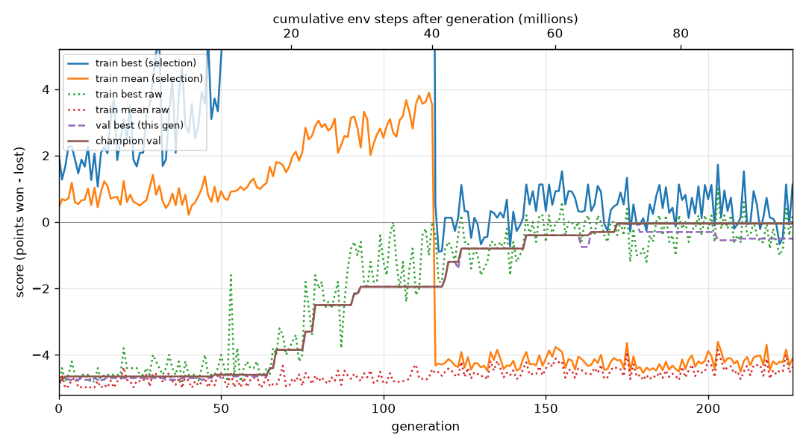

# Q1 — Slime volleyball with NEAT

**Result:** held-out mean **−0.37, 95% CI [−0.59, −0.15]** over 100 episodes → **T3**
(bonus not reached). The same inputs and shaping without the curriculum score −4.78.
The breakthrough happened on **1 of 3 seeds** with the identical command; see
*Replication*.

Every number here is re-derivable from `runs/<id>/` (schema in [LOGS.md](LOGS.md));
`analyze_run.py` recomputes them all (0 FAIL on both full runs). Commit history is the
lab notebook: each code change and each result is its own commit.

## Pipeline

- **`episode.py`** — `play_episode`: 3 sigmoid outputs → MultiBinary
  `[forward, backward, jump]`, each pressed if > 0.5. It also resets the opponent's RNN
  every episode (see *What went wrong* #1). `run_episode` records per-episode detail:
  points, ball contacts, returns, movement, jumps, court zone.
- **`evolve.py`** — fitness is the mean over 5 seeded games, shared by every genome in a
  generation and fresh each generation. The **champion is picked on 20 fixed validation
  seeds**, never on training fitness. Seed ranges are disjoint by construction:
  train `[0, 1e6)`, held-out `[1e6, 2e6)`, validation `2e6+`, probes `3e6+`.
  Snapshots are saved every 10M steps. The run stops at a generation boundary before the
  budget is reached, so no partial generation is thrown away.
- **Curriculum** (`--phase1-steps`) — until 40M steps, selection fitness per game is
  `returns + 0.3·steps/3000`, with no score term. After that it is
  `score + 0.3·steps/3000 + 0.07·min(returns, 9)`. `evolve.py` rejects any setting where
  shaping could reach one point.
- **`configs/relative.ini`** — differences from the shipped config:
  - two derived inputs, `ball x − my x` and `ball y − my y`
  - sigmoid only
  - `response 0.2`
  - lower delete probabilities
  - `compatibility_threshold 2.0`

  The shipped `neat_config.ini` keeps 12 inputs, which `sanity_check.sh` asserts.
- **Tools:**
  - `evaluate.py` — held-out score, t interval and bootstrap interval
  - `analyze_run.py` — consistency, bias and degeneracy checks with formulas
  - `reward_check.py` — ranks fixed policies under each fitness formula
  - `replay.py` / `replay_snapshots.py` — GIFs with a contacts HUD, cross-checked
    against the logs
  - `architecture.py`, `behavior.py`
  - `pipeline_test.py` — the falsification test in *What went wrong* #4

**Reproduce the best run** (conda env `astra`, Python 3.11; ~25 min on 9 cores):

```sh
python evolve.py --seed 0 --config configs/relative.ini \
  --phase1-steps 40000000 --phase1-survival 0.3 \
  --survival-bonus 0.3 --return-bonus 0.07 --return-cap 9 --run-id full100m_curriculum_s0
python evaluate.py --winner runs/full100m_curriculum_s0/champion.pkl --episodes 100
```

The run used 98,527,682 of 100,000,000 steps over 227 generations. Re-running the same
command (checked with the final code on 1.5M-step runs) gives byte-identical
`genomes.jsonl`, `validation.jsonl` and champion. Only wall-clock timing fields differ.

## Fitness curve



Phase 1 runs to generation 116. The selection-fitness lines (blue and orange) measure
returns, so they sit above zero. At the switch they drop onto the score scale. The
lines worth reading are *train best raw* (green) and *champion val* (brown).

- **Generations 0–60:** flat at −4.7. The population is a net camper (see *Behavior*).
- **Generations 60–116:** the champion climbs −4.6 → −1.95 while score is **not** part of
  fitness. Learning to return the ball is what moved the score.
- **After the switch:** the champion climbs to −0.05 on validation by generation 172 and
  then plateaus.
- **The population mean raw stays near −4.5 throughout.** Most offspring of good genomes
  are broken by mutation, so the mean is not a progress measure here.

Two confounds are measured, not assumed:
- **Seed difficulty:** 68% of generation-to-generation jitter in training-best is
  explained by shifts in seed difficulty. This is why a fixed-seed validation track
  exists.
- **Winner's curse:** among validated genomes, training overstates validation by +0.15
  [0.10, 0.19].

Baseline curve: `runs/full100m_baseline_s0/analysis/` — flat for all 420 generations.

## Champion evaluation

| | curriculum (best run) | baseline (no curriculum) |
|---|---|---|
| mean score, 100 held-out episodes | **−0.370** | −4.780 |
| 95% CI (t / bootstrap) | [−0.593, −0.147] / [−0.590, −0.150] | [−4.872, −4.688] |
| W / D / L | 19 / 38 / 43 | 0 / 0 / 100 |
| points won / lost | 38 / 75 | 22 / 500 |
| tier | **T3** (≥ −1.0; the whole CI is above it) | T1 |

Validation picked the champion. The 60M snapshot scored better on 20 held-out games
(0.00 vs −0.35), but the intervals overlap and choosing on held-out data would bias the
headline, so I didn't.

## Champion architecture

Genome 9993 has 14 inputs and **8 nodes** (3 outputs + 5 hidden) with
**11 enabled connections** (34 disabled). The effective network, counting only nodes
on an input→output path, is **6 nodes and 10 connections**. Every node uses
**sigmoid** with sum aggregation, response 0.2, feed-forward. Full table:
[architecture.md](runs/full100m_curriculum_s0/architecture.md).

The wiring is readable:
- **Strongest weight:** `backward ← (ball x − my x) × +11.24`, meaning *step back when
  the ball is behind me*. This is ball tracking through a single weight on the relative
  input, the mechanism that input was added to make reachable.
- `forward ← ball vx × −4.13`: step forward when the ball heads toward the net.
- **Jump:** its bias (×5 inside neat's sigmoid) outweighs its inputs, so it is always on.

## Behavioral analysis

Watched across 10M snapshots, on the same held-out game each time:
`runs/full100m_curriculum_s0/snapshots/replays/` and `snapshots/progress.md`.

1. **Net camper (0–10M, and the baseline throughout).** Presses forward and jump, sits
   pinned against the net hopping, and never chases. 93% of its lost points land behind
   it. It is one bias mutation from random play and blocks the odd ball, which is why
   it is such a strong trap.
2. **Chasing (10–20M).** The 10M generation-best already makes 26 contacts per game, and
   87% of its jumps hit the ball by 20M.
3. **Rallying (30M →).** Covers its whole half (61% of time at the net, 24% mid, 15%
   back) and moves 453 units per game (built-in policy ~555). Makes 69 contacts and 18
   returns per game. **Every game reaches the 3000-step limit.**

**Degenerate and exploit-like behavior:**
- **Jumps on 100% of steps** from 30M on. It steers while airborne, and 61% of its jumps
  still hit the ball.
- **Multi-touch possession:** the ball is on its half 67% of the time (built-in policy
  49%), with 0.26 returns per contact (built-in 0.53).
- `analyze_run`'s juggling detector **fired** at population level: 0.12 returns per
  contact, timeouts rising 0% → 10%. I tested whether this is clock-running instead of
  accepting it:
  - The champion's longest hold is 254 / 333 steps (mean / max), against the built-in
    policy's 185 / 292. A staller would hold for thousands.
  - The built-in policy playing against itself also reaches the time limit in 20 of 20
    games. Timeouts are what competent play looks like in this environment.
  - **Verdict:** not clock-running, but the possession style is real.
- **How it loses** ([behavior.md](runs/full100m_curriculum_s0/behavior.md)): 48% of lost
  points are its own touch dropping in front of it, 17% are untouched serves, and 0%
  land behind it. **Its T3 comes mostly from not losing:** 38 draws out of 100 games.
- **It is weakest at the start.** Over 40 held-out games it lost 33 points.
  - 42% of them came in the first 300 steps (the first 10% of the game).
  - 24% came within 100 steps of a serve, and 7 were serves it never touched.
  - 16 of 40 games had no point lost at all.
  - Once into the rally rhythm it rarely loses. This is a learned weakness I report
    rather than shape away, since a penalty on serve losses would invite stalling.

**What shaping did:**
- **Survival-only shaping (B=0.5):** separated a hand-written tracker from the net
  camper by just 0.06 per game, inside the noise. That run stayed flat for 83
  generations.
- **Phase-1 objective:** separates them by 2.4 (3.10 vs 0.66). It never ranks a policy
  above one with more points (`reward_check.py`, probe seeds).
- The survival term likely produced the possession-heavy style, since keeping the ball
  aloft keeps the game going.

## What went wrong, and how I found it

1. **The opponent remembered the previous game.** `env.reset()` never resets the
   built-in opponent's RNN. Replaying seed 7 twice gave 2903 steps, then 1194. An
   auditor agent found replays diverged at step 0 on 30 of 30 seeds. Without this fix,
   seeding could never make results reproducible. Fix: reset `env.policy` in
   `play_episode`. Afterwards a replay matches a fresh env exactly.
2. **The champion was the luckiest score, and the curve was partly measuring the
   seeds.**
   - The shipped driver keeps the highest training fitness ever seen. In generation 0,
     a genome tied at −4.0 re-scored −4.9 on fresh seeds.
   - Measured on a 20M run, training overstates validation by +0.20 [0.17, 0.23].
     Validation has its own version of this: in the baseline, the champion picked at
     −4.55 out of ~1,260 validated genomes scores −4.78 held-out.
   - Fix: champion chosen on fixed validation seeds, a validation track added to the
     curve, and only held-out numbers reported.
3. **Five runs learned nothing, and the logs at first could only say *that*, not
   *why*.**
   - 89% of games were 5–0 losses. In most generations, 85–100% of genomes had the same
     points-won vector: points were decided by the serve, not the genome.
   - I added ball-contact counting by wrapping `Particle.bounce`. Trajectories are
     byte-identical with and without the wrapper. Contacts were 1.5 per game, the same
     as random play (1.4).
   - The replays showed the net camper, and the logs agreed: forward 93%, pinned at the
     net more than 90% of the time.
4. **Was the pipeline broken, or the objective?** A generation-0 champion went unbeaten
   for 83 generations, so I tested the pipeline directly (`pipeline_test.py`): same
   `evolve.py`, fitness swapped for ball contacts.
   - Mean contacts went 1.57 → 3.10 in 5M steps, so the pipeline works.
   - The problem was noise. Per-game score has sd ~0.33 from serve luck, while shaping
     differences under my "< 1 point" cap were about 0.03–0.05. A 5-game fitness has
     SE 0.15; the entire camper → tracker gap was 0.20.
   - This led directly to the curriculum.
5. **I introduced a reward hack myself.** My first return bonus was uncapped. Winning
   points ends the game sooner, so a 0–0 rally to the time limit could out-earn a quick
   5–0 win.
   - Fix: cap at 9 returns, and refuse any `B + R·cap ≥ 1`.
   - `reward_check.py` now tests every formula against fixed policies: idle, camper,
     backline hider, random, hand-written tracker, the built-in policy.
6. **Budget plumbing.**
   - The shipped generation-boundary stop could never fire: 7 workers × ⌊100M/7⌋ <
     100M. Every run ended with a worker hitting its cap mid-generation, discarding up
     to 5.35% of the budget.
   - My first guard then stopped runs at 81% of budget. Validation sent 3 big jobs to 3
     workers, so those workers hit their caps early.
   - Fix: one episode per job. Per-worker spread fell from 11% to 1.3%, with results
     identical game by game, and the full runs used 98.5–99.2% of the budget.
   - `budget.py` itself is untouched.
7. **Smaller bugs, each caught by a test.**
   - The CI used a fixed t = 1.984 (df = 99); for 20 episodes it should be 2.093, so
     intervals were 5% too narrow.
   - The relative-input change crashed hand-written policies (`AttributeError`).
   - Snapshot labels collided below 10M, and the 20M snapshot was skipped because runs
     stop just short of round numbers.
   - The replay cut games off at 1400 steps (seed 2 showed −1 instead of −3).

## Replication, and anything surprising

- **The breakthrough is seed-dependent: 1 of 3 seeds.** Identical command, 100
  held-out episodes each:

  | seed | held-out mean [95% CI] | best phase-1 fitness | champion |
  |---|---|---|---|
  | **0** | **−0.37 [−0.59, −0.15]** | 25.1 | rallying player |
  | 1 | −4.77 [−4.86, −4.68] | 3.1 | net camper |
  | 2 | −4.79 [−4.87, −4.71] | 3.7 | net camper |

  - Seeds 1 and 2 never found the first chasing behavior. They stayed at 99% of time at
    the net and are indistinguishable from the no-curriculum baseline (−4.78).
  - The curriculum makes the breakthrough *possible* but does not make it reliable.
    Escaping the net-camper trap is a rare discovery event: seed 0's 10M gen-best was
    already chasing.
  - I fixed seed 0 as the headline *before* seeing seeds 1–2, so selection on held-out
    cannot have inflated it. But one success in three is the honest description of the
    method.
  - The obvious next step (not done, for time) is making the discovery likely: more
    seeds, a larger population early on, or restarting stuck runs. Run dirs:
    `runs/full100m_curriculum_s{1,2}`.
- **Timeouts are normal for competent play:** the built-in policy playing against itself
  reaches the 3000-step limit in every game. Any "stalling" detector needs that
  baseline.
- **Population mean stays near −4.5 even when the best is about 0.** In this space,
  mutation is mostly destructive near good genomes.
- **Time:** about 2 h of session time (16:08 → 18:00 by commit timestamps). The live walkthrough could take any commit;
  `git log` shows the order things were found.
