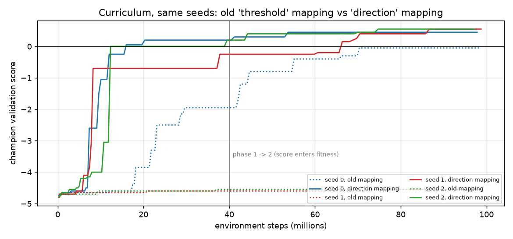

# Q1 — Slime volleyball with NEAT

**Result (3 seeds, 100 held-out episodes each):** every seed reaches **T3 or better** and
the mean across seeds is **+0.10**.

| seed | held-out mean [95% CI] | W / D / L |
|---|---|---|
| 0 | −0.16 [−0.37, +0.05] | 19 / 45 / 36 |
| 1 | **+0.34 [+0.14, +0.54]** | 39 / 45 / 16 |
| 2 | +0.12 [−0.06, +0.30] | 30 / 44 / 26 |

**Bonus tier (> 0) reached.** I committed a headline rule before these runs: pick the
best *validation* score. Seeds 1 and 2 tie on it at +0.55. I don't break the tie with
held-out data, and the claim doesn't need me to: both tied champions are above 0
held-out.

Getting here took one change to how outputs become actions (*How the replication was
fixed*). With the original mapping, the identical command escaped the net-camper trap
on **1 of 3** seeds (−0.37 / −4.77 / −4.79).

Every number here is re-derivable from `runs/<id>/` (schema in [LOGS.md](LOGS.md));
`analyze_run.py` recomputes them all (0 FAIL on every full run). The commit history is
the lab notebook.

## Pipeline

- **`episode.py`** — `play_episode(net, env)` (signature unchanged):
  - resets the built-in opponent's RNN every episode (*What went wrong* #1)
  - maps outputs to actions through `action_from_outputs`, using the mapping the run's
    config declares
  - **`direction`** (used for the headline): 2 sigmoid outputs. One sets movement:
    above 2/3 forward, below 1/3 backward, otherwise stay. The other jumps when above
    0.5.
  - **`threshold`** (original): 3 outputs, each button pressed when above 0.5.
  - `run_episode` records points, ball contacts, returns, movement, jumps and court
    zone for every episode.
- **`evolve.py`** — fitness is the mean over 5 seeded games, shared by the whole
  generation and fresh each generation.
  - The **champion is picked on 20 fixed validation seeds**, never on training fitness.
  - Seed ranges are disjoint: train `[0, 1e6)`, held-out `[1e6, 2e6)`, validation
    `2e6+`, probes `3e6+`.
  - Snapshots every 10M steps.
  - Stops at a generation boundary within budget.
  - Any crash is recorded in the run directory.
- **Curriculum** (`--phase1-steps 40M`) — selection fitness per game is
  `returns + 0.3·steps/3000` until 40M steps, with no score term. After that it is
  `score + 0.3·steps/3000 + 0.07·min(returns, 9)`. Shaping is capped below one point
  (B + R·cap = 0.93 < 1).
- **Configs** — `configs/direction_r1.ini` differs from the original shipped
  `neat_config.ini` (first commit) only in:
  - 2 derived inputs (`ball x − my x`, `ball y − my y`)
  - sigmoid-only nodes
  - lower delete probabilities
  - `compatibility_threshold 2.0`
  - 2 outputs with `[Action] mapping = direction`

  The `[Action]` section is our own; neat ignores it, `evolve.load_config` reads it,
  and `make_net` attaches it to the network. Response stays at 1.0, the shipped value.
  `neat_config.ini` itself was changed early on (`dc6408d`: sigmoid-only,
  compatibility 2.0) but keeps 12 inputs and 3 outputs, which `sanity_check.sh` asserts.
- **Tools:**
  - `evaluate.py` — t interval and bootstrap interval
  - `analyze_run.py`
  - `reward_check.py` — ranks fixed policies under every fitness formula
  - `mapping_check.py`
  - `replay.py` / `replay_snapshots.py` — HUD, cross-checked against the logs
  - `architecture.py`, `behavior.py`
  - `pipeline_test.py`
  - `experiments/` — the hypothesis, mapping and replication scripts

**Reproduce** (conda env `astra`, Python 3.11; ~25 min on 9 cores; seeds 0, 1, 2):

```sh
python evolve.py --seed 1 --config configs/direction_r1.ini \
  --phase1-steps 40000000 --phase1-survival 0.3 \
  --survival-bonus 0.3 --return-bonus 0.07 --return-cap 9 --run-id full100m_direction_s1
python evaluate.py --winner runs/full100m_direction_s1/champion.pkl --episodes 100
```

`experiments/full_direction.sh` runs all three seeds plus evaluation and replays. The
same command reproduces byte-identical `genomes.jsonl`, `validation.jsonl` and champion,
whether run with 3 or 9 workers.

## Fitness curve



Champion validation score against steps, same seeds, same fitness; only the action
mapping differs.
- **Direction mapping:** every seed escapes −4.7 between 7M and 12M steps. Seeds 0 and
  2 reach 0 by 20M, *before score is part of fitness*. All three end at +0.45 to +0.55.
- **Old mapping:** seed 0 escapes later (~17M); seeds 1 and 2 stay net campers for the
  whole budget.

Per-run curves with population best and mean, train and raw:
`runs/full100m_direction_s*/analysis/fitness_curve.png`.
- The population **mean** raw score stays near −4.5 even late on. Mutation mostly breaks
  good genomes, so it is not a progress measure.
- Two confounds are measured each run:
  - 72–83% of generation-to-generation jitter in training-best comes from seed
    difficulty.
  - Training overstates validation by +0.16 to +0.24 (winner's curse).
  - Both are why only held-out numbers are reported.

## Champion evaluation

| | seed 0 | seed 1 | seed 2 | old mapping (s0/s1/s2) | no curriculum |
|---|---|---|---|---|---|
| held-out mean | −0.160 | **+0.340** | +0.120 | −0.37 / −4.77 / −4.79 | −4.78 |
| 95% CI (t) | [−0.365, +0.045] | [+0.140, +0.540] | [−0.063, +0.303] | | [−4.87, −4.69] |
| 95% CI (bootstrap) | [−0.350, +0.050] | [+0.140, +0.540] | [−0.060, +0.300] | | |
| W / D / L | 19/45/36 | 39/45/16 | 30/44/26 | | 0/0/100 |
| points won / lost | 39/55 | 63/29 | 46/34 | | 22/500 |
| tier | T3 | bonus (CI > 0) | bonus (mean > 0) | T3 / T1 / T1 | T1 |

Every game reaches the 3000-step limit, which is normal for competent play here (see
*Behavior*).

## Champion architecture

| champion | nodes (outputs + hidden) | enabled connections | effective nodes / connections | activations |
|---|---|---|---|---|
| seed 0 | 6 (2 + 4) | 10 (16 disabled) | 6 / 10 | sigmoid × 6 |
| seed 1 | 4 (2 + 2) | 19 (13 disabled) | 4 / 19 | sigmoid × 4 |
| seed 2 | 4 (2 + 2) | 16 (11 disabled) | 4 / 16 | sigmoid × 4 |

All are feed-forward, sum aggregation, response 1.0. Tables:
`runs/full100m_direction_s*/architecture.md`.

- **All three found the same core:** `direction ← (ball x − my x)` with weight
  −8.1 / −11.5 / −11.4, meaning *move toward the ball's x*. That's the one-weight
  tracker `mapping_check.py` predicted.
- **Seed 1 also learned jump timing:** its jump output is driven mainly by the ball's
  vertical velocity (−5.2), and it jumps on 44% of steps. Seed 0 jumps on 99%.

## Behavioral analysis

Seed 1's replays at 10M → 60M → final (`runs/full100m_direction_s1/snapshots/replays/`)
show the progression net camper → chasing → rallying. Behaviour on 20 held-out games
(`behavior.py`):

| | seed 0 | seed 1 | seed 2 | built-in policy (our seat) |
|---|---|---|---|---|
| ball on our half | 55% | 56% | 67% | 49% |
| longest hold, mean / max (steps) | 143 / 184 | 126 / 154 | 334 / 498 | 185 / 292 |
| contacts / returns per game | 64 / 25.5 | 64 / 26.1 | 81 / 15.8 | 45 / 24 |
| distance moved per game | 612 | 706 | 913 | ~555 |
| time at the net / mid / back | 75 / 17 / 8% | 76 / 17 / 7% | 54 / 21 / 25% | |
| jump pressed | 99% of steps | 44% | 74% | |

- **Strategy:** all three track the ball's x along their whole half and play it back.
  - Points are won by forcing errors: the opponent touched last.
  - Points are lost mostly to their own touch dropping short in front of them (seeds
    0 and 1).
  - Seed 2 loses more balls behind it but holds possession longer.
- **Exploit-like behaviour, checked rather than assumed:**
  - `analyze_run`'s juggling detector fires at *population* level. Many genomes touch
    the ball often and rarely return it, which is plausibly the survival term rewarding
    keeping the ball alive.
  - The champions are filtered by raw validation score. Seeds 0 and 1 hold the ball
    *less* than the built-in policy, and seed 2 holds it longer (max 498 steps), but
    nowhere near clock-running.
  - Timeouts are not a stalling signal: the built-in policy playing against itself
    reaches the 3000-step limit in 20 of 20 games.
- **Constant jumping** (seed 0, and the old T3 champion) is not required for good play.
  Seed 1, the strongest, jumps on 44% of steps.
- **Earlier finding** (old T3 champion): 42% of its lost points came in the first 300
  steps of a game, so openings were its weak spot.
- **What shaping did:**
  - Survival-only shaping separated a ball-tracker from a net camper by 0.06, inside
    the noise.
  - The phase-1 objective separates them by 2.4.
  - **But phase 1 is only a stepping stone.** `reward_check` with the final champions
    shows it ranking seed 0's champion (most returns, 25.8) above seed 2's and the
    built-in policy, which win more points. So "more returns" stops tracking "more
    points" once agents can rally.
  - The score-based phase-2 formula passes that check, and all three champions were
    selected in phase 2 (generations 99 / 141 / 128; the switch was at ~82).

## What went wrong, and how I found it

1. **The opponent remembered the previous game.** `env.reset()` never resets the
   built-in opponent's RNN: seed 7 replayed twice gave 2903 steps, then 1194. An auditor
   agent found 30 of 30 replays diverged at step 0. Fixed in `play_episode`; a replay
   now matches a fresh env exactly.
2. **The champion was the luckiest score, and the curve partly measured the seeds.**
   The shipped driver keeps the highest training fitness ever seen. Training overstates
   validation by +0.15 to +0.24, and validation overstates held-out too: the baseline's
   −4.55 became −4.78. Fix: a validation-picked champion, a validation track on the
   curve, and only held-out numbers reported.
3. **Five runs learned nothing, and at first the logs could only say *that*.**
   - 89% of games were 5–0 losses, and 85–100% of genomes per generation had the same
     points vector, decided by the serve.
   - I added contact counting by wrapping `Particle.bounce`. Trajectories are
     byte-identical with and without it. Contacts were 1.5 per game, the same as
     random play.
   - Replays showed the net camper.
4. **Pipeline or objective?** A generation-0 champion went unbeaten for 83 generations.
   `pipeline_test.py` swaps fitness for contacts in the same `evolve.py`: contacts went
   1.57 → 3.10, so the pipeline works. Score noise (5-game SE 0.15) swamped a 0.20
   camper → tracker gap, which led to the curriculum.
5. **I introduced a reward hack myself.** My first return bonus was uncapped, so a 0–0
   rally to the time limit out-earned a quick 5–0 win. Fixed by a cap of 9 plus
   enforcing `B + R·cap < 1`. `reward_check.py` guards every formula.
6. **Budget plumbing.**
   - The shipped generation-boundary stop could never fire (7 × ⌊100M/7⌋ < 100M), so
     up to 5.35% of the budget was thrown away mid-generation.
   - My first guard then stopped runs at 81%, because validation jobs piled onto 3
     workers.
   - One episode per job fixed it: identical results, spread 11% → 1.3%, 97–99% of
     budget used. `budget.py` is untouched.
7. **Smaller bugs, each caught by a test:**
   - a fixed t = 1.984 for 20-episode CIs (should be 2.093)
   - the relative-input change crashing hand-written policies
   - snapshot labels colliding, and the 20M snapshot being skipped
   - replays truncated at 1400 steps
8. **A run died silently.** `evolve.py` only caught budget stops, and the script sent
   stderr to `/dev/null`. Reproduced with stderr kept: neat's `RuntimeError` (33
   species × 2 > population 64). Crashes are now recorded and outputs still written.
   The rerun was byte-identical with 3 vs 9 workers.
9. **The method worked on 1 of 3 seeds, and five plausible fixes didn't help.** The
   cause was the action mapping, found by ablation. Full story below.
10. **The stepping-stone objective is misaligned at the top end.** Found by re-running
    `reward_check` with the final champions (see *Behavior*). It's harmless here
    because selection hands over to score at 40M, but a longer phase 1 would optimise
    the wrong thing.

## How the replication was fixed

**1. The problem.** With the original mapping, the identical curriculum command reached
−0.37 on seed 0 but stayed a net camper on seeds 1 and 2 (−4.77, −4.79). I fixed seed
0 as the headline before running them.

**2. Five hypotheses, one change each** (phase 1, 15M steps, fresh seeds 10–12;
`experiments/discovery_results.md`):

| hypothesis | change | escaped |
|---|---|---|
| control | — | 0/3 |
| H1 weights too small | init 1→3, mutation 0.5→1.0 | 0/3 |
| H2 too few genomes | population 64→192 | 0/3 |
| H3 evaluation noise | 10 games per genome | 0/3 |
| H4 deletion drift | delete probability → 0.05 | 0/3 |
| H5 lost diversity | compatibility 2.0→1.0 | 0/2 (+1 crashed, #8) |

H1's failure was the clue. It grew tracking weights as large as seed 0's champion's
(7.8–17.9) and still didn't chase.

**3. The diagnosis, by ablating seed 0's champion** (probe seeds):

| variant | phase-1 fitness | contacts |
|---|---|---|
| net camper (forward + jump) | 0.66 | 0.8 |
| full champion | 18.3 | 70 |
| remove `forward ← ball vx` | **0.66** (exactly a camper) | 0.8 |
| remove tracking, keep that link | **0.06** (worse than a camper) | 0.8 |

- A camper holds forward on, so a tracking signal on *backward* just cancels it and the
  agent stands still.
- Gating forward without tracking is *worse* than camping.
- So escaping needed two simultaneous changes, neither rewarded alone: a deceptive
  valley. None of H1–H5 changes that.

**4. The fix lives in the mapping, which the task leaves to us.**
`mapping_check.py` scores hand-built "camper + tracking strength k" policies:

| mapping | how fitness responds as k grows |
|---|---|
| threshold (original) | flat at 0.76 for every k up to 16 (valley) |
| signed (difference of the 2 outputs) | also flat: saturated outputs never clear its dead zone |
| **direction** | rises with k: 0.97 → 3.84 → 9.01 (7 → 29 → 45 contacts) |

With one movement output, the tracking weight acts directly against "forward on".

**5. Tested in evolution** (same protocol and seeds as step 2):

| arm | escaped |
|---|---|
| direction alone | 1/3 |
| direction + response 1.0 | **3/3** |
| direction + wide weights | 0/3 |

Response 1.0 matters: at 0.2 the tracking weight must reach ~20 instead of ~4.

**6. Full replication** on the original seeds 0–2, pre-registered in
`experiments/full_direction.sh`: 3 of 3 reach T3 or better (table at top). The fitness
formula is **identical** to the old runs; only the action mapping and response
changed, so no reward change can explain the gain.

## Rule compliance

Checked against README "Ground rules" and the Q1 section of QUESTIONS.md:

- **Never edited (byte-identical to the original first commit `d23a4bd`):** all three
  `budget.py` files, the environment `slimevolley.py`, `sanity_check.sh`,
  `package_submission.sh`, `requirements.txt`, `README.md`, `QUESTIONS.md`, and every Q2
  / Q3 file.
- **Original Q1 files I did change, each one the task opens up:**
  - `episode.py` ("the piece you implement"; `play_episode(net, env)` signature kept)
  - `evolve.py` ("everything else is your call")
  - `neat_config.ini` ("tuning it is fair game"; still 12 inputs, as `sanity_check.sh`
    asserts)
  - `replay.py` ("change it, or replace it")
  - `report.md`
- **Step budget:** recomputed from every committed `budget_log.jsonl` with the
  scaffold's own rule (sum of each worker's latest count). All 55 committed runs are at
  or under their budget; the maximum is 99,224,569 of 100M.
- **Disclosures, so nothing is hidden:**
  - **Contact counting wraps the env at runtime.** `episode.py` wraps
    `Particle.bounce`, which still calls the original, and counts touches. The file is
    not edited, and trajectories are byte-identical with and without the wrapper.
  - **Steps outside the budget.** Held-out evaluation and analysis episodes
    (`evaluate.py`, `behavior.py`, `reward_check.py`, `mapping_check.py`, replays) are
    not charged to any run's budget. They train nothing and select nothing; the budget
    governs training runs.
  - **Held-out seeds were seen, never used to choose.** During development, held-out
    seeds 1,000,000–1,000,019 (the first 20 of the 100) were used to *watch* snapshots
    in replays and progress tables. No champion, config or mapping was chosen on them.
    Choices used training logs, validation seeds or probe seeds (3e6+). The one time a
    held-out comparison favoured a different champion (60M snapshot, old run), I didn't
    switch.
  - **Throwaway runs.** Short plumbing and smoke-test runs (≤ 3M steps) were deleted
    without ever being committed.
  - **The crashed run's original logs are kept.** It was reproduced for its traceback,
    and its original logs are committed unaltered as
    `runs/dh_h5species_s11_crashed_original` next to the rerun; the two are
    byte-identical where they overlap.

## Anything surprising

- **The failure was in the action interface, not the reward or the search
  settings.** Five search-side fixes did nothing; one interface change made the
  breakthrough reliable.
- **A stepping-stone objective can go wrong once it succeeds.** Phase 1 was essential to
  escape the trap, and is misaligned at the top end.
- **Time:** about 3 h of session time (16:08 → 19:10 by commit timestamps). Q2/Q3 were not attempted by me. `git log` shows
  the order things were found.
