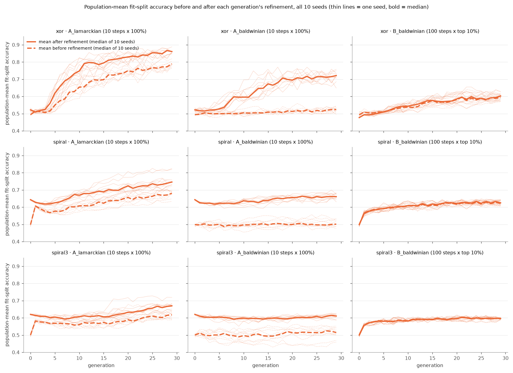
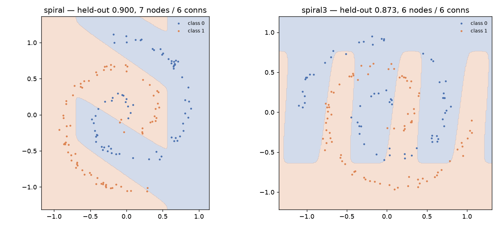

# Backprop-NEAT Under a Fixed Gradient Budget: Allocation, Inheritance, and Network Size

*ASTRA take-home, Question 2. Numbers are traceable to the committed files
named in captions. Each experiment's predictions were committed before it
ran (`experiments/PREDICTIONS_*.md`); bugs and corrections are logged in
`AUDIT.md` and `DEVLOG.md`.*

## Abstract

We combine NEAT topology search with gradient-based weight refinement on
three two-dimensional classification tasks (xor and two spirals) under a
budget of 30,000 gradient steps per run. At equal allocation, Lamarckian
inheritance, which writes refined weights back into the genome, outperforms
Baldwinian inheritance, which uses them only to score fitness, by 6.5–15.3
percentage points on both spirals, on three disjoint seed sets; at each
strategy's best allocation the gap is smaller (3.4 and 8.5 points).
Baldwinian inheritance gains from refining fewer genomes more deeply;
Lamarckian does not. Lamarckian offspring inherit a head start of 9–10
points, much of which mutation erases each generation. A linear size penalty
shrinks networks without improving accuracy, and decision-boundary analysis
shows that most spiral3 champions, and some spiral champions, fit the
densely sampled outer turns rather than the spiral itself. We report the
predictions that failed alongside those that held, and the corrections made
after an independent post-merge audit.

## 1. Introduction

NEAT evolves topology but tunes weights only by random mutation; gradient
descent tunes weights efficiently but cannot change topology. In
backprop-NEAT each genome's network is briefly trained ("refined") during
evaluation, and evolution acts on the result. Under a fixed budget, steps
spent refining one genome are steps not spent on another genome or another
generation. We study four questions: how to allocate the budget, whether
refined weights should be inherited, how a size penalty trades accuracy for
size, and what six or fewer connections can achieve.

| Deliverable | Section |
|---|---|
| 1. Refinement and held-out accuracy | 2, 3.1 |
| 2. Allocation study | 3.2 |
| 3. Lamarckian or Baldwinian | 3.3 |
| 4. Complexity frontier | 3.4 |
| 5. Six or fewer connections | 3.5 |
| 6. Decision boundaries | 3.6 |
| 7. What went wrong | 5 |

## 2. Method

**Data.** Each task has 350 training and 150 held-out points (provided,
frozen). xor is four overlapping Gaussian blobs (best achievable accuracy
0.984). The spirals are two interleaved arms making 1.30 and 1.50
revolutions; a nearest-neighbour classifier reaches 0.99 and 1.00. The
majority-class baseline is 0.513, 0.520 and 0.567. Points are denser at
large radius, so crude boundaries score well: the best single straight line
fitted on the training points reaches 0.70 (spiral) and 0.62 (spiral3)
held-out, and a corner-shaped cut 0.77 on spiral.
One held-out point is 0.67 percentage points.

**Refinement and budget.** Networks are feed-forward with a sigmoid output
(we pinned it; the provided configuration let it mutate, see Section 5).
Refinement minimises binary cross-entropy with full-batch Adam (learning
rate 0.3, chosen on training data), using a hand-written backward pass
verified against finite differences. Parameters are clipped to NEAT's ±30
range after each update. One gradient step is one full-batch gradient plus
one update; forward passes are free, as in the provided code, and no run
exceeded 30,000 steps.

**Evolution and inheritance.** NEAT runs with the provided configuration
(population 100). neat-python 2.0 reads that configuration's missing
`single_structural_mutation` setting as true, so every run, the baseline
included, applies one structural mutation per child; this affects all
configurations equally. Fitness is training accuracy after refinement (or
before it, for genomes not selected for refinement), minus a size penalty in
Section 3.4. Under allocation A every genome, elites included, is refined
each generation; under B and D an elite is refined only if selected again.
Adam starts afresh at every refinement. Under **Lamarckian** inheritance
refined weights are written back into the genome; under **Baldwinian**
inheritance the genome keeps its original weights, and the refined weights
are kept only to score it and to evaluate the final champion.

**Protocol.** The training points are split once into 280 *fit* points
(refinement, fitness) and 70 *validation* points (choosing the champion and
comparing configurations); held-out points are used only for reporting.
Each configuration runs with 10 seeds; we report mean ± standard deviation.
A champion's validation accuracy is the best over its run's generations, so
it is optimistic (2–4 points above held-out here); it is used only to
compare configurations of equal length.
Before each experiment we committed predictions. A predicted difference is
*supported* if it has the predicted sign and exceeds the typical seed
spread, √((sd₁² + sd₂²)/2), *contradicted* if it has the opposite sign by
that margin, and *inconclusive* otherwise.

## 3. Results

### 3.1 Main results

*Table 1. Held-out accuracy of the settled configurations (Section 3.2).
Seeds 10–12 were never used for a decision. Sources:
`runs/allocation/summary.md`, `runs/confirm/confirm_scored.md`.*

| Task | Configuration | Seeds 0–9 | Seeds 10–12 | Conns | Budget used |
|---|---|--:|--:|--:|---|
| xor | Lamarckian, 10 steps × all | 0.967 ± 0.007 | 0.967 ± 0.007 | 12.3 | 30,000 steps, 3,000 refinements |
| xor | Baldwinian, 100 steps × top 10% | 0.964 ± 0.018 | 0.971 ± 0.010 | 8.7 | 30,000 steps, 300 refinements |
| spiral | Lamarckian, 10 steps × all | 0.903 ± 0.069 | 0.889 ± 0.004 | 10.5 | 30,000 steps, 3,000 refinements |
| spiral | Baldwinian, 100 steps × top 10% | 0.869 ± 0.057 | 0.833 ± 0.064 | 9.1 | 30,000 steps, 300 refinements |
| spiral3 | Lamarckian, 10 steps × all | 0.825 ± 0.055 | 0.787 ± 0.037 | 10.2 | 30,000 steps, 3,000 refinements |
| spiral3 | Baldwinian, 100 steps × top 10% | 0.740 ± 0.060 | 0.682 ± 0.020 | 8.4 | 30,000 steps, 300 refinements |

Plain NEAT without refinement reaches 0.704, 0.749 and 0.620 (3 seeds).
Refinement helps on every task; xor reaches its ceiling, while both spirals
remain well below theirs.

### 3.2 Allocating the budget

We compared five allocations with both strategies (Table 2). Where only some
genomes are refined, they are chosen by unrefined fitness.

*Table 2. Allocations and held-out accuracy, seeds 0–9 (xor, validation
accuracy and spread in Appendix A1). Bold: the allocation chosen for each
strategy. n < 10 where neat-python stopped runs early (Section 3.3). Budget
per run: 30,000/30,000 steps over 3,000 (A), 300 (B), 600 (C) and 6,000 (E)
refinements; D 29,520/30,000 over 5,790 refinement calls.*

| | Allocation | Gens | Lamarckian spiral | Lamarckian spiral3 | Baldwinian spiral | Baldwinian spiral3 |
|---|---|--:|--:|--:|--:|--:|
| A | 10 steps × all 100 | 30 | **0.903** | **0.825** | 0.815 | 0.677 |
| B | 100 steps × top 10 | 30 | 0.877 (n=9) | 0.809 | **0.869** | **0.740** |
| C | 50 steps × all 100 | 6 | 0.808 | 0.736 | 0.845 | 0.695 |
| D | successive halving (100 × 2 steps, 50 × 4, … 6 × 32) | 30 | 0.903 (n=7) | 0.834 | 0.879 | 0.683 |
| E | 5 steps × all 100 | 60 | 0.877 | 0.793 | 0.851 | 0.673 |

A pilot first refined 100 genomes per task for 300 steps (Appendix A4).
Unrefined fitness barely predicted refined fitness (Spearman 0.07–0.09), and
on the spirals 10-step rankings were nearly unrelated to 300-step rankings.
A rule written in advance turned this into "100–300 steps, 1–3
generations"; we rejected it because it gave further generations no value,
while early runs were still improving at generation 29. From the pilot we
predicted that B and D would lose to A under Baldwinian inheritance, and
that C (six generations) would lose to A under both.

Three seeds gave mixed verdicts, so we added seeds 3–9 with the predictions
unchanged. With ten seeds, 2 predictions were supported, 5 contradicted and
3 inconclusive. Deep refinement of a few genomes (B) *helped* Baldwinian
inheritance by 5–6 points and did not help Lamarckian. We had priced B's
weakness (refining genomes chosen by an uninformative score) but not A's
under Baldwinian inheritance: its 10-step fitness is itself nearly
uninformative. Only "six generations hurt Lamarckian" held on both spirals
(−9.5 and −8.9 points). The B-versus-A comparison under Baldwinian
inheritance is not a clean test of depth: carried-over elites are re-refined
to identical results (wasting 24–29% of B's steps, 4–5% of A's), and with
fewer genomes refined, selection acts more on raw weights.

We chose, by mean validation accuracy on the spirals among allocations with
no crashed run, **A for Lamarckian** (0.891) and **B for Baldwinian**
(0.839). On the unused seeds 10–12, three of four committed claims held:
Lamarckian A beat Baldwinian A (+11.1, +14.0 points) and Baldwinian B
(+5.6, +10.4), and B beat A for Baldwinian (+5.6, +3.6). The fourth, that A
beats B for Lamarckian, did not hold; for Lamarckian the two are
indistinguishable.

### 3.3 Lamarckian versus Baldwinian inheritance

**Each strategy does what it claims.** Across the allocation study,
Lamarckian evaluation changed the stored weights of all 368,700 refined
genomes and Baldwinian evaluation changed none of 387,000. Tests confirm
that a Lamarckian elite's weights resume where its refinement ended (its
Adam state does not), while a Baldwinian elite repeats an identical
refinement. Figure 1 shows the effect on the population. At the same
allocation (A), the Lamarckian population's *unrefined* accuracy climbs to
0.79 / 0.68 / 0.62, while the Baldwinian population's stays at 0.52 / 0.50 /
0.52 for 30 generations even as its refined accuracy rises. Under
allocation B most genomes are scored unrefined, so selection acts on raw
weights and the unrefined mean rises to about 0.60.

*Figure 1. Population-mean training accuracy before (dashed) and after
(solid) refinement. Columns: Lamarckian A, Baldwinian A, Baldwinian B; rows:
xor, spiral, spiral3. Bold lines are medians over 10 seeds, thin lines
individual seeds.*

**The effect.** At equal allocation (A), Lamarckian beats Baldwinian on
spiral / spiral3 by +8.7 / +14.8 points (seeds 0–9), +11.1 / +14.0 (seeds
10–12) and +6.5 / +15.3 (seeds 20–29). At each strategy's chosen allocation
(Lamarckian A, Baldwinian B) the gap is +3.4 (within spread) / +8.5 (seeds
0–9) and +5.6 / +10.4 (seeds 10–12). Lamarckian runs also split into many
more species (maximum per completed run up to 46–50 under A, B and D; 1–15
under C and E) than Baldwinian runs (1–7). In 5 of 150 Lamarckian runs
neat-python stopped the run early because the species no longer fit in the
population; in 2 more it failed only after the final generation, and our
driver discarded those completed runs until the audit (Section 5).

**Mechanism.** We tested hypotheses in sequence (Table 3).

*Table 3. Mechanism experiments; predictions committed before each. Details
in Appendix A5–A8.*

| Hypothesis | Test and result | Verdict |
|---|---|---|
| H1: refinement accumulates along Lamarckian lineages; Baldwinian restarts from a short, noisy refinement | Lamarckian children start 12.9 points below their parents' refined accuracy (predicted: within 5). Like for like, children's unrefined accuracy is 0.596 (Lamarckian) vs 0.507 (Baldwinian). Refining Baldwinian genomes more deeply closes the gap from 8.7 to 0.6 points on spiral and from 14.8 to 8.5 on spiral3, but these arms also differ in wasted elite refinement (5–53% of steps) and in selection on raw weights. | Refuted as stated by its committed rule; a 9–10-point head start remains, and the depth effect is confounded |
| H2: species fragmentation is a harmless side effect | Speciating by topology alone removes fragmentation; the advantage stays within its predicted 0.5–1.5× (+10.9 on spiral3, 0.74×; +4.7 on spiral, 0.53×); Lamarckian's 3.6–3.9-point drop is within seed spread. | Not refuted |
| H3, H4: the head start is lost to weight perturbation or crossover | Clones lose as much as crosses (12.5 vs 12.9 points); reducing perturbation leaves the loss unchanged. | Both refuted |
| H5, H6: it is lost to weight replacement or activation changes | Mutating refined genomes one operator at a time: replacement ~60% of the damage, structural ~35%, perturbation ~30% (predicted ≤ 25%: failed), activation 8–10%; shares overlap and were measured on all snapshot genomes, not parents only. On seeds 20–29 (head-start logs on 20–22), disabling replacement recovers 2.5 points (predicted ≥ 3) and leaves accuracy unchanged. | H5 refuted as stated, though replacement is the largest single operator; H6 refuted |

By their committed rules, H1 and H5 are refuted as stated and H2 is not
refuted. What survives is a partial account: Lamarckian offspring inherit a
9–10-point head start, much of which mutation as a whole (not one operator)
erases; and because Adam restarts at every refinement, re-refining a trained
Lamarckian elite lowers its accuracy in about half to three-quarters of
cases. Baldwinian inheritance re-learns every generation from a refinement
too short to rank genomes; deeper refinement of fewer genomes narrows the
gap, but that comparison is confounded. Rounds 2–3 and the final test went
beyond the single follow-up we had committed to, though each was
pre-registered.

### 3.4 Complexity penalty

With C enabled connections and acc the refined training accuracy, our main
penalty is **linear**, fitness = acc − λC: each connection must buy at
least λ accuracy, on any task and at any size. We also tested a
**multiplicative** form, 1 − (1 − acc)(1 + λ√C), our reading of the
backprop-NEAT write-up, which describes the penalty in words only. With a
penalty, the champion is chosen by penalised validation accuracy.

*Figure 2. Held-out accuracy against champion size as the penalty strength
varies; top row linear, bottom row multiplicative. Error bars: standard
deviation over 10 seeds. Dashed: majority-class baseline.*

*Table 4. Linear penalty: held-out accuracy (mean connections), 10 seeds.
Every run spent 30,000/30,000 steps over 3,000 (Lamarckian) or 300
(Baldwinian) refinements. Source: `runs/frontier/frontier_scored.md`;
multiplicative in Appendix A13.*

| λ | Lam. xor | Lam. spiral | Lam. spiral3 | Bald. xor | Bald. spiral | Bald. spiral3 |
|---|--:|--:|--:|--:|--:|--:|
| 0 | 0.967 (12.3) | 0.903 (10.5) | 0.825 (10.2) | 0.964 (8.7) | 0.869 (9.1) | 0.740 (8.4) |
| 0.001 | 0.968 (7.3) | 0.910 (9.4) | 0.780 (8.3) | 0.973 (7.5) | 0.826 (6.7) | 0.693 (5.5) |
| 0.003 | 0.969 (7.2) | 0.861 (7.9) | 0.779 (6.8) | 0.967 (6.9) | 0.781 (4.9) | 0.676 (4.4) |
| 0.01 | 0.975 (6.6) | 0.855 (5.8) | 0.726 (4.2) | 0.855 (4.7) | 0.729 (3.4) | 0.641 (1.2) |
| 0.03 | 0.928 (5.0) | 0.685 (1.4) | 0.641 (1.2) | 0.585 (1.8) | 0.668 (1.0) | 0.633 (1.3) |

On xor the smallest penalty removes 5 of 12 connections at no cost, and
accuracy holds to about 6.6 connections. On the spirals, beyond the first
connection or two, every removed connection costs accuracy. On both spirals
Baldwinian inheritance lies below Lamarckian at every linear penalty
strength. No penalised configuration beat the unpenalised one by more than
the seed spread: the penalty buys size, not accuracy. Four predictions held,
one held in five of six cells, and one failed informatively: at
multiplicative λ = 1 every champion had zero connections. An empty network
pays no penalty (√0 = 0) and scores the constant-guess accuracy (about 0.51
on the fit split), while a spiral network with 15% error and 9 connections
scores 1 − 0.15 × 4 = 0.40, so under this reading the empty network becomes
optimal. Its held-out accuracy (0.487 / 0.480 / 0.433) falls below the
majority baseline because the training majority class is the held-out
minority.

### 3.5 Six or fewer connections

Each genome is repaired at creation to at most six enabled connections
(connections that do not affect the output first, then the smallest
weights), so no champion exceeds the limit. Sine and Gaussian activations
change NEAT's building blocks, so we report them separately.

*Table 5. Held-out accuracy with at most six connections, 10 seeds; every
run spent 30,000/30,000 steps over 3,000 (Lamarckian) or 300 (Baldwinian)
refinements. Bold: best with standard activations. Source:
`runs/smallnet/smallnet_scored.md`; verdicts in Appendix A12.*

| Task | Lamarckian | Baldwinian | Lamarckian + sine (separate) | Baldwinian + sine (separate) | Unconstrained Lamarckian |
|---|--:|--:|--:|--:|--:|
| xor | **0.967** ± 0.019 | 0.956 ± 0.020 | 0.969 ± 0.004 | 0.976 ± 0.006 | 0.967 (12.3 conns) |
| spiral | **0.826** ± 0.043 | 0.826 ± 0.071 | 0.906 ± 0.034 | 0.849 ± 0.048 | 0.903 (10.5) |
| spiral3 | **0.779** ± 0.030 | 0.711 ± 0.033 | 0.863 ± 0.049 | 0.816 ± 0.056 | 0.825 (10.2) |

With standard activations the limit costs nothing on xor and 7.7 and 4.6
points on the spirals. With sine and Gaussian units, six Lamarckian
connections match or exceed the unconstrained networks (Baldwinian with sine
reaches 0.849 on spiral against 0.869 unconstrained), but Figure 3 shows they
draw parallel
stripes whose spacing happens to match the arms, not spirals. Three graded
runs were executed during development before the predictions were written;
excluding them changes no mean by more than 0.004.

*Figure 3. Median-seed Lamarckian champions with sine units and at most six
connections: spiral (0.900) and spiral3 (0.873).*

### 3.6 Decision boundaries

Figure 4 shows median-seed champions for all three tasks; all seeds are in
`figures/seeds_*.png`.
Figure 5 measures whether the inner turns are learned by splitting held-out
points into three equal-count rings by radius.

*Figure 4. Median-seed champions: plain NEAT, Lamarckian A, Baldwinian B.
Rows: xor, spiral, spiral3.*

*Figure 5. Held-out accuracy by radius third; one dot per seed. Dotted:
majority class within the ring. Dashed: 5-nearest-neighbour reference.*

On xor, all ten Lamarckian champions draw the correct quadrants, while three
of ten Baldwinian champions cut off one blob diagonally and still score
0.93–0.95. On spiral, six of ten Lamarckian champions curl into the inner
arm; the other four are corners or boxes scoring 0.80–0.87 while doing no
better than the majority class near the centre. On spiral3, sixteen of
twenty refined champions do no better than the majority class on the inner
third; their 0.67–0.84 comes from shapes fitted to the outer turns, where
most points lie. On spiral3 especially, overall accuracy therefore mainly
measures the fit to the outer turns, and about 0.80 is reachable without
learning the spiral.

## 4. Discussion and limitations

Refinement helps on every task, Lamarckian inheritance outperforms
Baldwinian on the spirals at equal allocation, and Baldwinian inheritance
needs a different allocation from Lamarckian. The mechanism is only partly
established, and the networks found within this budget (8–12 connections)
rarely learn the inner turns of spiral3 (on spiral, 9 of 20 refined
champions curl inward). Ten seeds and 150 held-out points give wide
intervals, so differences below about five points warrant caution. Seeds
0–9 informed many decisions, which is why the main effect was re-tested on
seeds 10–12 and 20–29. Four protocol properties qualify the mechanism
results: Adam restarts at every refinement; Baldwinian elites are re-refined
to identical results, wasting steps in proportion to depth; one structural
mutation per child (a neat-python default, Section 2); and the pilot pooled
genomes across generations, whereas selection acts within one. The
plain-NEAT baseline predates the validation split and uses three seeds.
Natural next steps are to cache Baldwinian elite refinements and carry Adam
state for Lamarckian elites, then re-run the depth comparison; settle
allocations A and B for Lamarckian inheritance; and evaluate spirals by
inner-ring accuracy.

## 5. What went wrong, and how it was found

1. **Baldwinian champions would have been scored with unrefined weights.**
   The provided code rebuilt the champion from its genome, which under
   Baldwinian inheritance never holds the refined weights. Found by auditing
   the provided code before writing refinement; fixed by storing the
   refined weights for evaluation and plotting, with tests that offspring
   never inherit them.
2. **The output activation could mutate** (tanh or relu in 53% of genomes)
   while prediction thresholds at 0.5. Found by tabulating output ranges
   during the audit; fixed by pinning the output to sigmoid.
3. **An exit code had two meanings, and `--generations 0` was ignored.** A
   budget overrun and a crash both exited with code 1, and a zero silently
   became 30 generations. Found by the experiment-harness agent; fixed with
   a dedicated exit code, validation and a forced-overrun test.
4. **The learning-rate probe used validation data.** Found while reviewing
   the agent-written probe; rerun on fit points only, with the same result.
5. **The pilot misled twice**: its rule recommended 1–3 generations, and
   the predictions built on it were mostly contradicted (Section 3.2).
6. **Lamarckian runs fragmented until neat-python stopped them** (5 of 150
   early, 2 after their final generation). Found through the harness's crash
   report; the runs were kept as results, excluded from the allocation
   choice, and led to hypothesis H2. The post-merge audit found that the two
   late failures were completed runs that our driver had discarded; they are
   now kept (0.880 and 0.800) and the early stops write partial logs.
7. **Our own records contained errors.** Cross-checking commit messages
   against result files found a miscounted verdict tally, a species range
   generalised from three seeds, an overstated comparison and an outdated
   exit code. Each was re-derived and corrected with an appended note.
8. **An independent audit after merging found more.** Three auditors
   re-checked the code, the experiment logic and the report against the
   data. Every reported number reproduced, but they found the discarded
   completed runs (item 6, fixed and re-run), the neat-python
   structural-mutation default, Adam's restart, the wasted Baldwinian elite
   refinements, a head-start comparison of unlike quantities (5 points; 9–10
   like for like), and several claims stronger than the data (all corrected
   here; `DEVLOG.md` #17–#22).

Smaller issues are in `DEVLOG.md`, including a false warning in the provided
`package_submission.sh`: it reports that Q2 has no training runs because
its file search fails under `pipefail` when there are many files.

## 6. Reproducibility and process

Experiments run from `q2_backprop_neat/` with the harness, for example
`python experiments/run_grid.py experiments/grids/allocation.json --runs-root /tmp/repro`
(without `--runs-root` it resumes over the committed runs); a single settled
run is
`python main.py --dataset spiral --seed 0 --lr 0.3 --strategy lamarckian --steps 10 --refine-fraction 1.0`,
and the plain-NEAT baseline is `--steps 0 --generations 30 --val-frac 0`.
Scores and figures are regenerated by `experiments/score_*.py`,
`experiments/make_figures.py` and `experiments/make_smallnet_figure.py`.
Five test suites (gradient, fixes to the provided code, driver,
connection limit, harness) all pass. The work took about 3 hours 10 minutes
of the suggested 5, plus about an hour for the post-merge audit and its
corrections. The author set the questions, wrote every prediction
and interpreted every result; implementation pieces (gradient engine,
harness, connection limit, figures, a first report draft) were delegated to
coding agents, whose tests were re-run and outputs checked before each
commit.

---

## Appendix

### A1. Allocation study, all tasks (seeds 0–9)

*Held-out accuracy, mean ± sd (n). Sources: `runs/allocation/predictions_scored_seeds0-9.md`;
validation and budget columns from `runs/allocation/summary.md`.*

| Allocation | Strategy | xor | spiral | spiral3 | Budget used |
|---|---|--:|--:|--:|---|
| A: 10 × 100%, 30 gens | Lamarckian | 0.967 ± 0.007 (10) | 0.903 ± 0.069 (10) | 0.825 ± 0.055 (10) | 30,000 over 3,000 refinements |
| | Baldwinian | 0.973 ± 0.009 (10) | 0.815 ± 0.035 (10) | 0.677 ± 0.061 (10) | same |
| B: 100 × top 10%, 30 gens | Lamarckian | 0.967 ± 0.016 (10) | 0.877 ± 0.068 (9) | 0.809 ± 0.061 (10) | 30,000 over 300 |
| | Baldwinian | 0.964 ± 0.018 (10) | 0.869 ± 0.057 (10) | 0.740 ± 0.060 (10) | same |
| C: 50 × 100%, 6 gens | Lamarckian | 0.963 ± 0.017 (10) | 0.808 ± 0.038 (10) | 0.736 ± 0.024 (10) | 30,000 over 600 |
| | Baldwinian | 0.928 ± 0.082 (10) | 0.845 ± 0.024 (10) | 0.695 ± 0.033 (10) | same |
| D: halving, 30 gens | Lamarckian | 0.966 ± 0.013 (9) | 0.903 ± 0.050 (7) | 0.834 ± 0.040 (10) | 29,520 over 5,790 |
| | Baldwinian | 0.976 ± 0.006 (10) | 0.879 ± 0.059 (10) | 0.683 ± 0.027 (10) | same |
| E: 5 × 100%, 60 gens | Lamarckian | 0.968 ± 0.004 (10) | 0.877 ± 0.061 (10) | 0.793 ± 0.045 (10) | 30,000 over 6,000 |
| | Baldwinian | 0.966 ± 0.022 (10) | 0.851 ± 0.037 (10) | 0.673 ± 0.064 (10) | same |

Runs stopped early by neat-python (per-species minimum): Lamarckian B
spiral seed 4; Lamarckian D xor seed 1, spiral seeds 0, 6, 9. Lamarckian D
spiral3 seeds 0 and 1 completed all 30 generations but were discarded by a
driver bug until the post-merge audit (DEVLOG #17); they were re-run.

*Mean validation accuracy (xor / spiral / spiral3), used for the choice in
Section 3.2.*

| Allocation | Lamarckian | Baldwinian |
|---|---|---|
| A | 0.999 / 0.929 / 0.854 | 0.986 / 0.817 / 0.747 |
| B | 0.984 / 0.897 / 0.866 | 0.984 / 0.881 / 0.797 |
| C | 0.967 / 0.821 / 0.767 | 0.939 / 0.844 / 0.740 |
| D | 0.995 / 0.924 / 0.893 (completed runs) | 0.987 / 0.906 / 0.730 |
| E | 0.999 / 0.899 / 0.823 | 0.986 / 0.847 / 0.757 |

### A2. Allocation predictions and verdicts

*Difference from allocation A in held-out accuracy. Sources:
`runs/allocation/predictions_scored_seeds0-2.md`,
`runs/allocation/predictions_scored_seeds0-9.md`.*

| Prediction | Seeds 0–2 | Seeds 0–9 |
|---|---|---|
| P1 Baldwinian B < A, spiral | contradicted (+0.027) | contradicted (+0.053) |
| P1 Baldwinian B < A, spiral3 | inconclusive (+0.016) | contradicted (+0.063) |
| P1b B's deficit smaller under Lamarckian (B − A larger), spiral / spiral3 | inconclusive / inconclusive | contradicted / contradicted |
| P2 Lamarckian C < A, spiral | inconclusive (−0.051) | supported (−0.095) |
| P2 Lamarckian C < A, spiral3 | supported (−0.044) | supported (−0.089) |
| P2 Baldwinian C < A, spiral | contradicted (+0.069) | inconclusive (+0.029) |
| P2 Baldwinian C < A, spiral3 | supported (−0.069) | inconclusive (+0.018) |
| P3 Baldwinian D < A, spiral | contradicted (+0.136) | contradicted (+0.064) |
| P3 Baldwinian D < A, spiral3 | supported (−0.053) | inconclusive (+0.005) |

### A3. Confirmation (seeds 10–12)

*Held-out accuracy; 36 of 36 runs completed; budget as allocations A and B
(30,000/30,000 steps over 3,000 / 300 refinements). Source:
`runs/confirm/confirm_scored.md`.*

| Configuration | xor | spiral | spiral3 |
|---|--:|--:|--:|
| Lamarckian A | 0.967 ± 0.007 | 0.889 ± 0.004 | 0.787 ± 0.037 |
| Baldwinian A | 0.978 ± 0.004 | 0.778 ± 0.014 | 0.647 ± 0.041 |
| Lamarckian B | 0.978 ± 0.010 | 0.913 ± 0.040 | 0.787 ± 0.100 |
| Baldwinian B | 0.971 ± 0.010 | 0.833 ± 0.064 | 0.682 ± 0.020 |

### A4. Pilot measurements

*100 genomes per task from a Baldwinian run (seed 100), each refined for 300
steps. Source: `runs/pilot/pilot.json`.*

| | xor | spiral | spiral3 |
|---|--:|--:|--:|
| Spearman correlation, unrefined vs 300-step ranking | 0.069 | 0.073 | 0.089 |
| Spearman correlation, 10-step vs 300-step ranking | 0.707 | 0.017 | 0.272 |
| Median share of the 300-step gain reached after 10 steps | 0.72 | 0.99 | 0.89 |
| Eventual top 10 found in the top 10% by unrefined fitness | 0 | 1 | 2 |
| Eventual top 6 that successive halving would discard | 5 | 6 | 4 |
| Allocation recommended by the (rejected) rule | 100 steps, 3 gens | 200 steps, 1 gen | 300 steps, 1 gen |

### A5. Mechanism, round 1

*Held-out accuracy, 10 seeds; refinements per run: 3,000 (10 × 100%), 990 × 30 (30 × 33%),
300 (100 × 10%), 90 (300 × 3%). Source: `runs/mechanism/mechanism_scored.md`.*

| Configuration | Steps used | xor | spiral | spiral3 | Median max. species (spiral / spiral3) |
|---|---|--:|--:|--:|--:|
| Baldwinian, 10 × 100% | 30,000 | 0.973 ± 0.009 | 0.815 ± 0.035 | 0.677 ± 0.061 | 3 / 3 |
| Baldwinian, 30 × 33% | 29,700 | 0.975 ± 0.009 | 0.897 ± 0.038 | 0.695 ± 0.031 | 3 / 4 |
| Baldwinian, 100 × 10% | 30,000 | 0.964 ± 0.018 | 0.869 ± 0.057 | 0.740 ± 0.060 | 3 / 3 |
| Baldwinian, 300 × 3% | 27,000 | 0.912 ± 0.114 | 0.833 ± 0.067 | 0.727 ± 0.061 | 3 / 3 |
| Lamarckian, 10 × 100% | 30,000 | 0.967 ± 0.007 | 0.903 ± 0.069 | 0.825 ± 0.055 | 11 / 8.5 |
| Lamarckian, topology-only speciation | 30,000 | 0.967 ± 0.009 | 0.867 ± 0.052 | 0.786 ± 0.041 | 1 / 1 |
| Baldwinian, topology-only speciation | 30,000 | 0.970 ± 0.019 | 0.820 ± 0.055 | 0.677 ± 0.046 | 1 / 1 |

Median accuracy gain from refinement in generations 20–29: Lamarckian
+0.036, Baldwinian +0.125.

### A6. Mechanism, round 2

*Median loss of a child's unrefined accuracy relative to its parents'
refined accuracy. Source: `runs/mechanism2/mechanism2_scored.md`.*

| Children | Loss |
|---|--:|
| Lamarckian clones (n = 2,999) | −0.125 |
| Lamarckian crosses (n = 12,980) | −0.129 |
| Clones with unchanged structure (n = 852) | −0.089 |
| Lamarckian, reduced perturbation (n = 16,278) | −0.125 |
| Baldwinian, reduced perturbation (n = 16,870) | −0.207 |

Budget: every run 30,000/30,000 steps over 3,000 refinements. Held-out accuracy with reduced perturbation: Lamarckian 0.967 / 0.908 /
0.819, Baldwinian 0.920 / 0.821 / 0.645 (xor / spiral / spiral3).

### A7. Mechanism, round 3: damage by mutation operator

*No gradient steps beyond the 30,000-step snapshot run per task. Measured on all
300 snapshot genomes, not only those that reproduce (on parents only the damage
roughly doubles; shares hold). Mean change in training accuracy per mutant (share of the full mutation's
damage); 300 refined Lamarckian genomes per task, 20 mutants each. Source:
`runs/mechanism3/ablation.json`.*

| Operator | spiral | spiral3 |
|---|--:|--:|
| Weight/bias replacement | −0.055 (0.61) | −0.038 (0.60) |
| Structural (add/remove nodes and connections) | −0.035 (0.38) | −0.021 (0.32) |
| Weight/bias perturbation | −0.026 (0.28) | −0.022 (0.34) |
| Activation change | −0.007 (0.08) | −0.006 (0.10) |
| Full default mutation | −0.091 | −0.063 |
| Full mutation with reduced perturbation | −0.083 | −0.055 |

### A8. Mechanism, final test (seeds 20–29)

*Held-out accuracy; 120 of 120 runs completed, each 30,000/30,000 steps over
3,000 refinements. Source:
`runs/mechanism_final/final_scored.md`.*

| Configuration | xor | spiral | spiral3 |
|---|--:|--:|--:|
| Lamarckian, default | 0.968 ± 0.008 | 0.879 ± 0.047 | 0.807 ± 0.043 |
| Baldwinian, default | 0.956 ± 0.036 | 0.813 ± 0.032 | 0.655 ± 0.050 |
| Lamarckian, no replacement | 0.969 ± 0.009 | 0.889 ± 0.059 | 0.828 ± 0.060 |
| Baldwinian, no replacement | 0.955 ± 0.083 | 0.794 ± 0.025 | 0.701 ± 0.057 |

Median child loss under Lamarckian inheritance: −0.132 (default), −0.107
(no replacement).

### A9. Plain NEAT baseline

*Held-out accuracy, 30 generations, no refinement (0/30,000 gradient steps over 0
refinements). Reproduce with `--steps 0 --generations 30 --val-frac 0`. Source:
`runs/baseline_plain/*/summary.json`.*

| Task | Seed 0 | Seed 1 | Seed 2 | Mean ± sd |
|---|--:|--:|--:|--:|
| xor | 0.713 | 0.687 | 0.713 | 0.704 ± 0.015 |
| spiral | 0.760 | 0.793 | 0.693 | 0.749 ± 0.051 |
| spiral3 | 0.600 | 0.607 | 0.653 | 0.620 ± 0.029 |

### A10. First result (tag `q2-first-result`)

*Seed 0, 10 steps × all genomes, 30,000/30,000 steps over 3,000 refinements.
Source: `runs/first_result/summary.md`.*

| | xor | spiral | spiral3 |
|---|--:|--:|--:|
| Lamarckian | 0.973 | 0.800 | 0.780 |
| Baldwinian | 0.980 | 0.793 | 0.713 |

### A11. Test suites

| Suite | What it checks |
|---|---|
| `test_gradients.py` | Gradient against finite differences (evolved, refined and edge-case genomes; all activations), Adam, clipping, resumption |
| `test_scaffold_fixes.py` | Each fix to the provided code reproduces the original failure and confirms it is gone |
| `test_main.py` | Data split, budget accounting, inheritance evidence, halving schedule, champion selection, penalty, overrun, determinism |
| `test_smallnet.py` | Connection limit and repair; unchanged behaviour without the limit |
| `experiments/tests/test_harness.py` | 27 failure cases of the experiment harness |

### A12. Six-connection limit: verdicts and sensitivity

*Source: `runs/smallnet/smallnet_scored.md`; predictions in
`experiments/PREDICTIONS_smallnet.md`.*

| Prediction | Result |
|---|---|
| The limit costs xor little (both strategies) | supported |
| The limit costs the spirals accuracy | supported for Lamarckian; inconclusive for Baldwinian |
| Sine/Gaussian units help the spirals | supported in 3 of 4 cases (Baldwinian spiral inconclusive) |
| Sine/Gaussian units do not help xor | supported for Lamarckian; contradicted for Baldwinian (+0.020) |
| The Lamarckian advantage persists under the limit | holds on spiral3 (+0.069); not on spiral (+0.000) |

Budget: every run 30,000/30,000 steps over 3,000 (Lamarckian) or 300 (Baldwinian)
refinements. Excluding the three runs executed during development: Lamarckian spiral
0.830 (n = 9), Lamarckian spiral3 0.782 (n = 9), Baldwinian sine spiral
0.849 (n = 9). Two verdicts change: the spiral3 cost of the limit for
Lamarckian becomes inconclusive, and the Lamarckian advantage on spiral
becomes a negligible +0.004.

### A13. Multiplicative penalty

*Held-out accuracy (mean champion connections), 10 seeds; every run 30,000/30,000
steps over 3,000 (Lamarckian) or 300 (Baldwinian) refinements. Source:
`runs/frontier/frontier_scored.md`.*

| λ | Lamarckian xor | Lamarckian spiral | Lamarckian spiral3 | Baldwinian xor | Baldwinian spiral | Baldwinian spiral3 |
|---|--:|--:|--:|--:|--:|--:|
| 0.1 | 0.967 (9.1) | 0.831 (6.6) | 0.700 (4.3) | 0.663 (3.3) | 0.729 (4.4) | 0.624 (1.6) |
| 0.3 | 0.967 (8.9) | 0.759 (4.0) | 0.641 (1.2) | 0.567 (1.2) | 0.667 (1.3) | 0.643 (1.1) |
| 1.0 | 0.487 (0.0) | 0.480 (0.0) | 0.433 (0.0) | 0.487 (0.0) | 0.480 (0.0) | 0.433 (0.0) |
