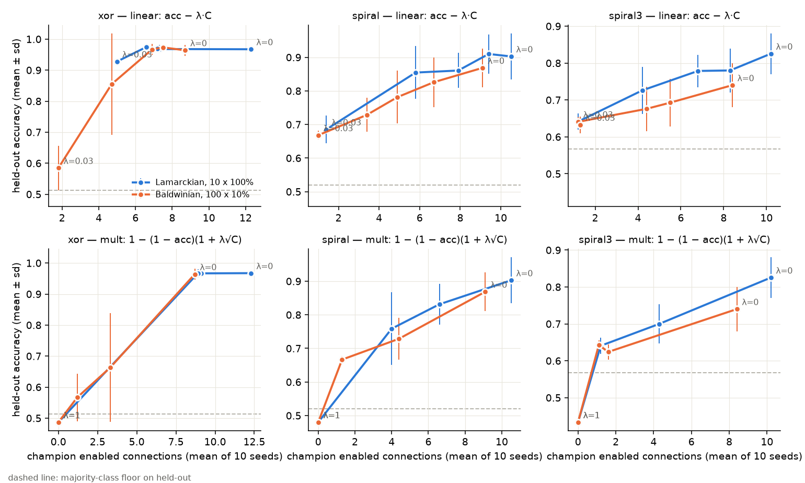
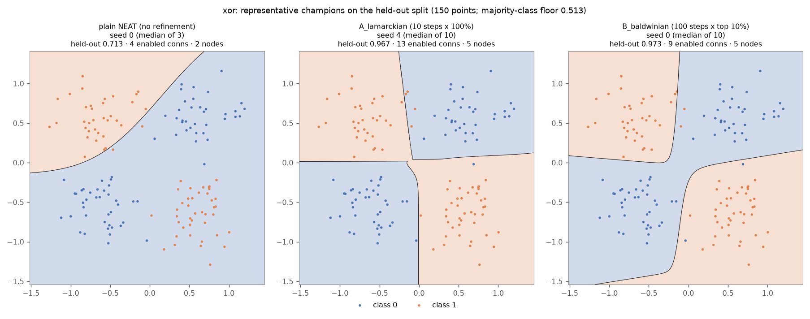
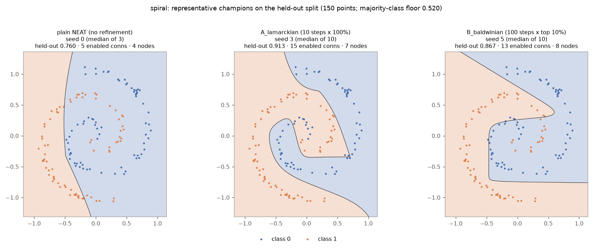
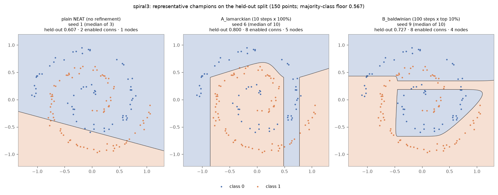
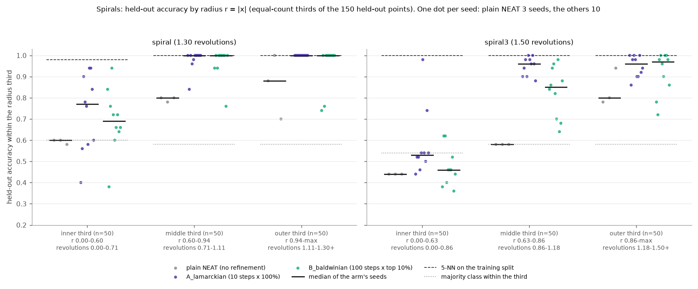

# Q2 — Backprop-NEAT under a compute budget

*Working draft. Section 6 is a placeholder: the small-network track is in
progress. Every number comes
from the committed file named beside it; where I derived a number while
writing (a sum or mean over a committed `results.csv` or
`fitness_history.csv`), I say so.*

**Summary**

- Refinement runs inside the NEAT loop. With the settled allocations,
  held-out mean over seeds 0–9 (xor / spiral / spiral3) is 0.967 / 0.903 /
  0.825 for Lamarckian and 0.964 / 0.869 / 0.740 for Baldwinian. Plain NEAT
  over the same 30 generations gets 0.704 / 0.749 / 0.620.
- xor is at its ceiling everywhere (Bayes-optimal 0.984). The spirals are
  far below theirs (k-NN reaches 0.99–1.00), so every difference worth
  discussing is on the spirals.
- At equal allocation, Lamarckian beats Baldwinian on the spirals on three
  disjoint seed sets, by +0.065 to +0.153.
- Most of my allocation predictions failed: 5 of 10 were contradicted at
  10 seeds, and half of the clear verdicts at 3 seeds did not survive to 10.
- The mechanism is only partly explained. Lamarckian inheritance carries
  refinement forward, but children lose about 0.13 of their parents'
  refined accuracy, and the one operator I could pin that on accounts for
  only 0.025.
- A linear size penalty buys smaller networks, never better ones: xor
  drops from 12 to 7 connections at no cost; on the spirals every removed
  connection costs accuracy. The write-up's multiplicative form, as I read
  it, has a degenerate optimum: at λ = 1 every champion has 0 connections.

## 1. What I built

**Gradients.** I wrote the backward pass by hand: reverse mode in
`GenomeNetwork.loss_and_grad` (`network.py`). The loss is mean binary
cross-entropy, computed from the output pre-activation in softplus form so
it stays finite past the ±60 sigmoid clip. Dead connections get exactly 0,
and relu takes its left derivative at z = 0. `test_gradients.py` checks the
gradient against finite differences on 300 evolved genomes and on the same
genomes after 300 Adam steps, plus hand-built edge cases and closed-form
logistic regression (worst error/tolerance 0.03 / 0.04). DEVLOG #6 records a
mutation test that caught 8 of 9 injected gradient bugs and 6 of 6 injected
Adam bugs (the injection script is not committed).

**Optimiser.** Full-batch Adam at lr 0.3. After every update the parameters
are projected onto the config's ±30 range, so what `write_back` stores is
what was evaluated. I chose the lr with `lr_probe.py` on the fit split only
(DEVLOG #9).

**One gradient step** means one full-batch gradient of the fit-split loss
plus one Adam update. No line searches, second-order steps or
finite-difference steps. Forward passes are free, as in the scaffold, and
the budget is charged for the steps actually taken.

**Fitness** is fit-split accuracy after refinement, minus the penalty when
there is one. A genome that is not refined keeps its pre-refinement
accuracy; ties go to the lower loss.

**Inheritance.** Lamarckian calls `net.write_back(genome)`. Baldwinian
leaves the genome untouched and keeps the refined vector only as
`genome.refined_params`, cleared at every evaluation, so the champion is
evaluated with the weights that earned its fitness.

**Elites** are refined again every generation under both strategies.
neat-python carries them over as the same objects (144 of 144 in the audit,
about 3.7 per generation), so Lamarckian elites accumulate refinement while
Baldwinian elites repeat, and pay for, an identical refinement. I kept this
so both strategies see the same protocol, and made it the first candidate
mechanism.

**Data split.** The 350 training points are split once, stratified, with a
fixed `VAL_SEED`: 280 fit points (refinement and fitness), 70 validation
points (choosing the champion and, in the harness, choosing between arms);
the 150 held-out points are only reported. The champion is the
generation-best genome with the highest validation accuracy (penalised
validation accuracy when there is a penalty, `66f5915`). An honest check:
every run also records the champion training fitness would have picked.
Over the 293 completed allocation cells, the validation choice differs from
it in held-out accuracy by a mean of −0.0024 and is identical in 197 cells
(derived from `runs/allocation/results.csv`). The split bought no
measurable accuracy; I kept it because it keeps every choice away from
held-out data.

**Allocations.** `fixed` refines the top `--refine-fraction` by
pre-refinement fitness for `--steps` each, with generations from
`budget.plan()`. `halving` refines 100 genomes × 2 steps, then 50 × 4,
25 × 8, 12 × 16 and 6 × 32: 984 steps per generation, 29,520 over 30.

**Penalty.** C is the number of enabled connections, the count the question
uses. `main.penalised` implements:

| form | fitness |
|---|---|
| linear | acc − λC |
| sqrt | acc − λ√C |
| mult | 1 − (1 − acc)(1 + λ√C) |

Linear is the main sweep: λ reads directly as the accuracy a connection must
buy, the same on every dataset and at every size. The backprop-NEAT write-up
says in words that fitness is multiplied by a factor that grows with
√connections, but gives no formula; `mult` is my reading of it, with the
factor applied to the error so that larger means worse. `sqrt` is
implemented but not swept.

**Harness.** `experiments/run_grid.py` runs grids in parallel, classifies
each cell (ok, invalid-budget, crashed, timeout, missing, args-mismatch),
records each run's git commit and a fingerprint of its code, and selects
arms on validation only.

**Reproducing the settled runs**, from `q2_backprop_neat/`:

```
python experiments/run_grid.py experiments/grids/allocation.json   # seeds 0-9
python experiments/run_grid.py experiments/grids/confirm.json      # seeds 10-12
python main.py --dataset spiral --seed 0 --lr 0.3 --strategy lamarckian --steps 10  --refine-fraction 1.0 --run-id repro/lam_A
python main.py --dataset spiral --seed 0 --lr 0.3 --strategy baldwinian --steps 100 --refine-fraction 0.1 --run-id repro/bald_B
```

## 2. Results (deliverable 1)

The settled allocations are Lamarckian A (10 steps × 100% refined, 30
generations) and Baldwinian B (100 steps × top 10%, 30 generations);
section 3 says why. Held-out accuracy, mean ± sample sd. Seeds 0–9 from
`runs/allocation/summary.md`; seeds 10–12, never used for a decision, from
`runs/confirm/confirm_scored.md`.

| dataset | strategy / allocation | held-out, seeds 0–9 | held-out, seeds 10–12 | val (0–9) | conns (0–9) | `budget.summary()` (every cell) |
|---|---|--:|--:|--:|--:|---|
| xor | Lamarckian A | 0.967 ± 0.007 | 0.967 ± 0.007 | 0.999 | 12.3 | 30,000/30,000 gradient steps over 3,000 refinements |
| xor | Baldwinian B | 0.964 ± 0.018 | 0.971 ± 0.010 | 0.984 | 8.7 | 30,000/30,000 gradient steps over 300 refinements |
| spiral | Lamarckian A | 0.903 ± 0.069 | 0.889 ± 0.004 | 0.929 | 10.5 | 30,000/30,000 gradient steps over 3,000 refinements |
| spiral | Baldwinian B | 0.869 ± 0.057 | 0.833 ± 0.064 | 0.881 | 9.1 | 30,000/30,000 gradient steps over 300 refinements |
| spiral3 | Lamarckian A | 0.825 ± 0.055 | 0.787 ± 0.037 | 0.854 | 10.2 | 30,000/30,000 gradient steps over 3,000 refinements |
| spiral3 | Baldwinian B | 0.740 ± 0.060 | 0.682 ± 0.020 | 0.797 | 8.4 | 30,000/30,000 gradient steps over 300 refinements |

| dataset | majority class (held-out) | plain NEAT, 30 gens, seeds 0–2 | k-NN held-out (AUDIT.md) |
|---|--:|--:|--:|
| xor | 0.513 | 0.704 ± 0.015 | 0.960–0.993 (Bayes-optimal 0.984) |
| spiral | 0.520 | 0.749 ± 0.051 | 0.987–0.993 |
| spiral3 | 0.567 | 0.620 ± 0.029 | 1.000 |

Every baseline run reports `0/30,000 gradient steps over 0 refinements`.
The baseline is not quite like-for-like: it ran at `11e5994`, before the
validation split (champion chosen on training fitness over all 350
points), and has 3 seeds. The seed spread is large: Lamarckian A on spiral
ranges from 0.800 to 0.980, and one held-out point is 0.67%. Accuracy
alone also cannot show that a spiral was learned: the shipped plain-NEAT
spiral champion scored 0.767 with a corner cut (AUDIT, "Facts about the
frozen data"); section 7 settles this.

## 3. Allocation study (deliverable 2)

**Pilot.** Before choosing arms I refined 100 genomes per dataset to 300
steps (`experiments/pilot.py`, seed 100, which no grid uses; 60,000 steps
per dataset, outside any graded run), sampled from generations 0, 10, 20,
29 of a Baldwinian run (Appendix A4). Findings: pre-refinement fitness
barely predicts post-refinement fitness (Spearman ρ 0.07–0.09); 10-step
rankings are near-random on the spirals (ρ 0.02 / 0.27) although 10 steps
give 89–99% of the median gain there; successive halving would cut 4–6 of
the 300-step top 6.

My rule written in advance (steps where ρ ≥ 0.9, a fraction whose
pre-screen recalls 9 of 10) gave 100 / 200 / 300 steps × 100%, leaving
3 / 1 / 1 generations. That is degenerate: it prices how well refinement
ranks a fixed set of genomes and gives generations no value. `first_result`
showed evolution still improving at the end (champions from generations
21–29; mean connections per genome growing from 2.0 to 5.6–11.9,
`runs/first_result/*/*/fitness_history.csv`). I kept the measurements and
discarded the rule (`1f87a0b`).

**Predictions, committed before the grid** (`dfa1495`,
`PREDICTIONS_allocation.md`): P1 Baldwinian B < A on the spirals (B picks
whom to refine by an uninformative score); P1b the B − A gap is smaller
under Lamarckian; P2 C < A under both strategies (6 generations too few to
grow networks); P3 Baldwinian D < A (late bloomers). Verdict rule:
*supported* if the difference has the predicted sign and |diff| >
sqrt((sd_X² + sd_A²)/2), *contradicted* if the opposite sign by that much,
*inconclusive* otherwise.

**Grid.** 5 allocations × 2 strategies × 3 datasets, first on seeds 0–2
(90 runs): 3 supported, 3 contradicted, 4 inconclusive, with spiral and
spiral3 disagreeing in direction for C and D and seed sd up to 0.10. (I
first miscounted this as "4 supported, 4 contradicted" in a commit message;
corrected in `ef2763e`.) **After seeing them** I added seeds 3–9 (`34dc34c`),
predictions and rule unchanged, both seed sets scored and labelled, and
moved the untouched confirmation set from seeds 3–5 to 10–12.

Held-out on the spirals, seeds 0–9 (`runs/allocation/summary.md`; xor and
validation in Appendix A1):

| arm | allocation | gens | `budget.summary()` | Lam spiral | Lam spiral3 | Bald spiral | Bald spiral3 |
|---|---|--:|---|--:|--:|--:|--:|
| A | 10 steps × 100% | 30 | 30,000/30,000 over 3,000 refinements | 0.903 ± 0.069 | 0.825 ± 0.055 | 0.815 ± 0.035 | 0.677 ± 0.061 |
| B | 100 steps × top 10% | 30 | 30,000/30,000 over 300 | 0.877 ± 0.068 (n=9) | 0.809 ± 0.061 | 0.869 ± 0.057 | 0.740 ± 0.060 |
| C | 50 steps × 100% | 6 | 30,000/30,000 over 600 | 0.808 ± 0.038 | 0.736 ± 0.024 | 0.845 ± 0.024 | 0.695 ± 0.033 |
| D | successive halving | 30 | 29,520/30,000 over 5,790 | 0.903 ± 0.050 (n=7) | 0.833 ± 0.040 (n=8) | 0.879 ± 0.059 | 0.683 ± 0.027 |
| E | 5 steps × 100% | 60 | 30,000/30,000 over 6,000 | 0.877 ± 0.061 | 0.793 ± 0.045 | 0.851 ± 0.037 | 0.673 ± 0.064 |

**Verdicts at seeds 0–9** (Appendix A2): 2 supported, 5 contradicted, 3
inconclusive. P1 and P1b are contradicted on both spirals: B *helps*
Baldwinian (+0.053 / +0.063) and does not help Lamarckian. P3 is
contradicted on spiral (D − A = +0.064). Only P2 for Lamarckian is supported
on both spirals (−0.095 / −0.089). Three of the six clear verdicts at 3
seeds became inconclusive at 10. My reading of P1 (interpretation, tested
in section 4): I priced B's weakness — choosing whom to refine by an
uninformative score — but not A's matching weakness under Baldwinian, a
10-step fitness that is itself near-random on the spirals.

**Crashes.** 7 of 150 Lamarckian cells crashed (B 1, D 6), 0 Baldwinian,
all with neat-python's `population size 100 is less than num_species *
min_species_size 102 (51 * 2)`. Kept as results, not re-run (section 8,
item 6).

**Settled allocation, and why.** Mean validation accuracy over the spiral
and spiral3 cells of seeds 0–9 (xor is at its ceiling in every arm), among
arms with no crashed cell (clarified in `PREDICTIONS_confirm.md`):
- **Lamarckian A** (0.891; C 0.794, E 0.861). B and D had crashes; D's
  means are over 7 and 8 survivors, and an allocation that fails 6 of 30
  runs is not one I can recommend whatever its survivors score.
- **Baldwinian B** (0.839; A 0.782, C 0.792, D 0.818, E 0.802).
Averaging over all three datasets gives the same choices.

**Confirmation on untouched seeds 10–12** (claims `3d04b21`, results
`7749e0b`, Appendix A3):

| claim | spiral | spiral3 | |
|---|--:|--:|---|
| C1: Lamarckian A > Baldwinian A | +0.111 | +0.140 | holds |
| C2: Baldwinian B > Baldwinian A | +0.056 | +0.036 | holds |
| C3: Lamarckian B < Lamarckian A | +0.024 | +0.000 | **does not hold** |
| C4: Lamarckian A > Baldwinian B | +0.056 | +0.104 | holds |

So for Lamarckian I cannot tell A and B apart. I kept A rather than choose
on the confirmation set.

## 4. Lamarckian or Baldwinian (deliverable 3)

**What it does, and the evidence.** `--strategy` selects either. I checked
that each does what I intended rather than assuming it. `test_main.py`
checks from the runs' own logs: "refined weights written into the genome —
300/300 genomes changed" (Lamarckian) against "genome weights never change
— 0/300 genomes changed" (Baldwinian); a Lamarckian elite carried into the
next generation "starts where its refinement ended" (its weight hash and
pre-refinement loss equal its previous post-refinement values); a
Baldwinian elite "repeats an identical refinement"; and a Baldwinian
champion's genome weights differ from the refined ones it is evaluated
with. The graded runs agree: over the completed allocation-grid runs,
Baldwinian refined 387,000 genome evaluations and changed 0 genomes;
Lamarckian refined 368,700 and changed 368,700 (derived by summing
`n_genome_changed` and `n_refined` over `runs/allocation/*/*/fitness_history.csv`).

The population shows it too (`figures/inheritance_signature.png`): at the
same allocation (10 steps x 100%), the Lamarckian population's own
pre-refinement accuracy climbs over 30 generations to 0.79 / 0.68 / 0.62
(median of 10 seeds; xor / spiral / spiral3), while the Baldwinian
population's stays at 0.52 / 0.50 / 0.52 the whole time even as its
post-refinement accuracy rises. Under Baldwinian, selection acts only on
how well a genome learns; its raw weights never improve, and nothing of
what is learned is assimilated into the genome within 30 generations.

**The difference to explain.** At equal allocation (A), Lamarckian −
Baldwinian held-out:

| seeds | spiral | spiral3 |
|---|--:|--:|
| 0–9 (allocation grid) | +0.088 | +0.148 |
| 10–12 (confirmation) | +0.111 | +0.140 |
| 20–29 (final test) | +0.065 | +0.153 |

The strategies also prefer different allocations, and Lamarckian runs
fragment: maximum species per run A 5–46, B 16–49, D 11–50 (C 1–15, E 3–14),
against 1–7 in every Baldwinian arm (recomputed from `n_species`;
corrected in `ef2763e`).

**The chain of hypotheses.** Before each round I committed its predictions
and verdict rules (`PREDICTIONS_mechanism*.md`); each round's runs record
that commit. Seeds 0–9 unless stated; Appendices A5–A8.

| round | hypothesis | committed prediction | result | what it settled |
|---|---|---|---|---|
| 1 (`f2ef424`→`5453173`) | **H1 accumulation**: Lamarckian refinement adds up along lineages; Baldwinian restarts every generation from shallow, noisy 10-step fitness | M1: Baldwinian at 300 × 3% beats 10 × 100% | **inconclusive**: inverted U (spiral 0.815 → 0.897 at 30 steps → 0.833 at 300) | depth helps until too few genomes are refined |
| | | M2: depth closes ≥ half the gap | spiral 0.087 → 0.006 **supported**; spiral3 0.148 → 0.085 **partial** | closable on spiral, not on spiral3 |
| | | M5: Lamarckian children start within 0.05 of parents' refined accuracy | −0.129 (n = 15,979): **contradicted**; Baldwinian −0.179 | carry-over exists (~0.05 better than Baldwinian) but is lossy |
| | **H2**: fragmentation is a side effect | M3: topology-only speciation stops it | median 1 species, no crashes: **supported** | |
| | | M4: the advantage survives without it | spiral +0.047 **inconclusive**; spiral3 +0.109 **supported** | partly refuted: without weight-aware speciation Lamarckian loses 0.036 / 0.039, Baldwinian nothing |
| 2 (`01bd9d3`→`81a30c5`) | **H3** parameter perturbation vs **H4** crossover | A: clones lose as much as crosses (H3) or clearly less (H4) | clones −0.125, crosses −0.129 | **H4 refuted**; clones with unchanged node/connection counts still lose 0.089 |
| | | B1: perturbation 0.8/0.7 → 0.2 brings the loss above −0.08 | still −0.125: **contradicted** | **H3 as stated refuted** (B2 inconclusive) |
| 3 (`3528f38`→`ee3e292`) | **H5** weight/bias replacement vs **H6** activation mutation | operator share of mutation damage ≥ 0.4 (refined genomes, seed 100) | replace 0.61 / 0.60: **H5 supported**; activation 0.08 / 0.10: not; perturb 0.28 / 0.34 vs check C2 ≤ 0.25: **contradicted** | replacement is the largest single operator; shares overlap (sum > 1) |
| final (`045e57d`→`ebccd07`), fresh seeds 20–29 | replacement causes the loss | F1: without replacement, children keep ≥ 0.03 more | +0.025 (−0.132 → −0.107; 5 of 6 runs): **contradicted**, narrowly | replacement explains part of the loss |
| | | F2: removing it helps Lamarckian more | interaction +0.030 / −0.026: **inconclusive** | |
| | | F3: the effect replicates | +0.065 / +0.153: **supported** | |

Two caveats on my own evidence: round 2's Test A was scored "H3 supported"
by its own rule, but Test B then refuted H3, so Test A only ever showed that
crossover is not the cause. In round 3 I changed `mutation_ablation.py`
after committing its predictions (a fresh config has no innovation tracker,
so the low-mutation operator is built from the run's own config; diff
`3528f38..ee3e292`); the change touched only that consistency arm.

**Status** (`experiments/MECHANISM_SUMMARY.md`). Supported: Lamarckian's
advantage is robust; inherited refinement gives a partial head start;
Baldwinian's handicap is shallow, noisy fitness, and refining fewer genomes
more deeply recovers part of the gap. The carry-over is eroded by mutation
as a whole; no single operator accounts for it, and recovering 0.025 of it
did not change final accuracy measurably. Unexplained: why Lamarckian
needs weight-aware speciation; why depth closes the gap on spiral but not
spiral3; where most of the ~0.13 per-generation loss comes from. I stopped
there, by the stopping rule committed in `PREDICTIONS_mechanism2.md`.

## 5. Complexity frontier (deliverable 4)

Design and predictions committed before running (`02e29c7`,
`PREDICTIONS_frontier.md`); results `85a4b96`
(`runs/frontier/frontier_scored.md`, `figures/frontier.png`). Settled
allocations, 30 generations, seeds 0–9, all three datasets: linear λ = 0,
0.001, 0.003, 0.01, 0.03 and mult λ = 0.1, 0.3, 1.0 (480 runs, all ok, all
with one code fingerprint). The champion is chosen on penalised validation
accuracy (`66f5915`), so selection cannot undo the size pressure; λ = 0
reproduces the allocation grid's cells exactly.



Held-out mean (champion enabled connections), 10 seeds; full table with sd
in the scored file:

| penalty | Lam xor | Lam spiral | Lam spiral3 | Bald xor | Bald spiral | Bald spiral3 |
|---|--:|--:|--:|--:|--:|--:|
| none (λ = 0) | 0.967 (12.3) | 0.903 (10.5) | 0.825 (10.2) | 0.964 (8.7) | 0.869 (9.1) | 0.740 (8.4) |
| linear 0.001 | 0.968 (7.3) | 0.910 (9.4) | 0.780 (8.3) | 0.973 (7.5) | 0.826 (6.7) | 0.693 (5.5) |
| linear 0.003 | 0.969 (7.2) | 0.861 (7.9) | 0.779 (6.8) | 0.967 (6.9) | 0.781 (4.9) | 0.676 (4.4) |
| linear 0.01 | 0.975 (6.6) | 0.855 (5.8) | 0.726 (4.2) | 0.855 (4.7) | 0.729 (3.4) | 0.641 (1.2) |
| linear 0.03 | 0.928 (5.0) | 0.685 (1.4) | 0.641 (1.2) | 0.585 (1.8) | 0.668 (1.0) | 0.633 (1.3) |
| mult 0.1 | 0.967 (9.1) | 0.831 (6.6) | 0.700 (4.3) | 0.663 (3.3) | 0.729 (4.4) | 0.624 (1.6) |
| mult 0.3 | 0.967 (8.9) | 0.759 (4.0) | 0.641 (1.2) | 0.567 (1.2) | 0.667 (1.3) | 0.643 (1.1) |
| mult 1.0 | 0.487 (0.0) | 0.480 (0.0) | 0.433 (0.0) | 0.487 (0.0) | 0.480 (0.0) | 0.433 (0.0) |

**Shape.** On xor the frontier has a free region: a tiny linear penalty
(0.001) cuts Lamarckian champions from 12.3 to 7.3 connections at no
accuracy cost — they were carrying connections that did nothing — and
accuracy holds down to about 6.6 connections, then falls. On the spirals
there is no free region: accuracy falls with every connection removed, as
expected for problems that need 4–8 hidden units. Baldwinian sits below
Lamarckian at every λ and collapses sooner (xor 0.855 at λ = 0.01 with
seeds splitting between solved and collapsed).

**Verdicts.** FP1 (penalty shrinks networks, 6/6 cells), FP2 (monotone in
λ), FP4 (no penalised arm beats λ = 0 beyond spread — the penalty buys size,
not accuracy) and FP6 (Lamarckian ≥ Baldwinian at every linear λ, 10/10)
supported; FP3 (at λ = 0.01 xor holds, spirals drop) 5 of 6 cells as
predicted (Lamarckian spiral's drop, −0.048, is within its spread 0.074).
**FP5 contradicted**: I predicted the mult form would shrink xor less than
spiral3, but at λ = 1 every champion in every run has 0 connections and
predicts a single class. The mult form's penalty is λ√C times the error, and
√0 = 0, so an empty network pays nothing and scores its constant-guess
accuracy (about 0.51 on the fit split). A spiral network with error 0.15 and
9 connections scores 1 − 0.15 × (1 + 3) = 0.40 at λ = 1, so the empty
network wins. Its held-out accuracy
(0.487 / 0.480 / 0.433) is *below* the majority floor because the training
majority is the held-out minority. The linear form has no such cliff,
which is why it is the main sweep.

## 6. Small-network track (deliverable 5)

**TODO(smallnet)**: in progress. Plan: `--max-conns 6`, settled
allocations, 10 seeds, all three datasets, standard activations (sigmoid,
tanh, relu), plus a separately labelled arm adding sine and gaussian
(adding activations changes NEAT's toolbox, so that arm is not comparable
with the unconstrained numbers). For reference, the frontier already shows
what ≤ 6-connection champions reach under a penalty: Lamarckian xor 0.928
at 5.0 connections, spiral 0.855 at 5.8 (linear λ = 0.01).

| dataset | ≤ 6 conns, standard activations | ≤ 6 conns, + sine/gauss (separate) | unconstrained (Lam A, seeds 0–9) |
|---|--:|--:|--:|
| xor | TODO(smallnet) | TODO(smallnet) | 0.967 ± 0.007 |
| spiral | TODO(smallnet) | TODO(smallnet) | 0.903 ± 0.069 |
| spiral3 | TODO(smallnet) | TODO(smallnet) | 0.825 ± 0.055 |

## 7. Decision boundaries (deliverable 6)

`figures/` (regenerate with `python experiments/make_figures.py`; per-figure
readings with the seeds each claim covers are in `figures/README.md`).
Champions are drawn through `champion_net()`, so Baldwinian boundaries use
the refined weights that earned their fitness (the scaffold drew unrefined
ones, AUDIT #1); the recomputed held-out accuracy of all 69 plotted
champions matches their `summary.json`. The representative panel is the
lower-median seed of 10; `seeds_*.png` show all 10 seeds unsorted, so
nothing below is cherry-picked. The question the plots answer is whether a
spiral score is a spiral, since a single cut already scores ~0.75 here.






- **xor — right shape.** All 10 Lamarckian champions split the plane into
  four quadrants along the axes (0.960–0.980; Bayes 0.984). 7/10 Baldwinian
  do; the other 3 (s1, s7, s9) cut one blob off with a diagonal — the wrong
  orientation, still 0.933–0.953. Plain NEAT draws one cut around one blob
  (0.687–0.713). Off the data the quadrants break down (`wide_view.png`);
  held-out data never tests that.
- **spiral — partly a spiral.** Plain NEAT is one near-vertical cut
  (0.69–0.79). 6/10 Lamarckian champions curl a class-1 tongue into the
  inner arm (inner-third accuracy 0.76–0.94, scores 0.913–0.980); the other
  4 are corners or boxes that score 0.800–0.867 while getting the inner
  third at or below its majority rate — right score, wrong shape.
  Baldwinian: 3 curl, 3 vertical stripes, 4 boxes.
- **spiral3 — mostly not a spiral.** 16 of 20 refined champions are at or
  below the majority rate on the inner third (the inner 0.86 revolutions).
  Their 0.67–0.87 comes from boxes, U-shapes and stripes that fit the outer
  turns, where most points sit (point density grows with radius). One
  Lamarckian champion (s5, 0.953) winds with the inner arm. The median
  Lamarckian champion (s6, 0.800) is axis-aligned boxes and stripes.
- **Across both spirals** no champion changes label along a ray from the
  centre as often as the data do (at most 1.87 flips per ray against 2.43
  for a 5-NN classifier).

What the shapes say: held-out accuracy on these spirals mostly rewards
fitting the dense outer turns, and ~0.80 is reachable without learning the
spiral. Refinement and Lamarckian inheritance raise accuracy there; only on
spiral does Lamarckian refinement reliably start winding inward
(inner-third median 0.77, Baldwinian 0.69, plain NEAT 0.60). The champions
are small (8–12 connections), which is consistent with the frontier: on the
spirals every connection is still paying for itself.

## 8. What went wrong, and how I found it (deliverable 7)

**1. A Baldwinian champion would have been scored with its unrefined
weights.** *What broke*: the shipped `main.py` and `viz.py` rebuilt the
champion from its genome; under Baldwinian inheritance the genome never
holds the refined weights, so every Baldwinian result would have been
under-reported — exactly the comparison deliverable 3 asks about. *How I
found it*: reading the scaffold before writing any refinement, which is why
I audited first. *What I did*: evaluation stores `genome.refined_params`,
`champion_net()` loads it, cleared at every evaluation. *Verified*:
`test_scaffold_fixes.py` "0 leaked, 63 held by carried-over elites";
`test_main.py` checks a Baldwinian champion's genome weights differ from its
refined ones and reported accuracies are `champion_net`'s.

**2. The output node's activation mutated.** *What broke*: the output was
tanh in 43% of evaluated genomes and relu in 10%, while `predict()`
thresholds at 0.5, `forward()` was documented as returning logits, and a
likelihood loss needs a probability. *How I found it*: `audit_scaffold.py`
tabulated output ranges per activation. *What I did*: `SigmoidOutputGenome`
pins outputs to sigmoid; its first version crashed with `NoSectionError`,
because neat-python reads the ini section named after the genome class
(DEVLOG #1). *Verified*: outputs stay sigmoid over 40 generations while
hidden nodes still mutate; the loss refuses a non-sigmoid output.

**3. Exit code 1 meant two things, and `--generations 0` was silently
ignored.** *What broke*: my first fix made an over-budget run exit 1, which
is also Python's uncaught-exception code; `--steps 0 --generations 0`
crashed inside neat-python, exited 1 with no summary, and could have been
filed as a budget overrun. `args.generations or planned` treated 0 as unset,
so the run reported 0 generations and ran 30. *How I found it*: the harness
agent, reasoning about exit codes and then reproducing both (DEVLOG #3,
#4). *What I did*: over budget exits 4, `--generations` must be ≥ 1, and the
harness needs exit 4 + `within_budget: false` + no traceback. *Verified*:
"overrun exits 4, keeps logs, marked invalid — 1,010/1,000 gradient steps
over 101 refinements" (`test_main.py`).

**4. My learning-rate probe used validation data.** *What broke*: the
engine agent's `lr_probe.py` tuned on all 350 training points, including
the 70 that choose the champion. *How I found it*: reviewing the agent's
report, not by a test. *What I did*: restricted the probe to the 280 fit
points. *Verified*: re-run, it still recommends lr 0.3 (DEVLOG #9).

**5. The pilot's rule, and the predictions built on the pilot.** The rule
recommended 1–3 generations; I put it beside `first_result`, where evolution
was still improving at generation 29, and discarded it. The hand-written
predictions then failed the other way: the pilot's most striking findings
(an uninformative pre-screen, late bloomers) predicted B and D would lose
to A under Baldwinian; on spiral at 10 seeds both won (+0.053, +0.064). How
a fixed set of genomes ranks is not what decides an evolutionary run.

**6. Lamarckian runs fragment until neat-python crashes.** *What broke*: 7
Lamarckian cells crashed on the per-species minimum. Lamarckian weights
reach ±30, NEAT's compatibility distance has a weight term, and lineages
drift past the threshold into more species than 100 genomes can hold at 2
each. *How I found it*: the harness reported the crashes. *What I did*:
kept the crashed cells as results, excluded crashed arms from the choice,
treated D's means as survivor-biased, and made fragmentation hypothesis H2.
*Verified*: topology-only speciation removes it (median 1 species, 0
crashes) but costs Lamarckian 0.036 / 0.039. *Still missing*: a crashed run
writes no `fitness_history.csv` (`main.py` catches only the budget
exception), so the species trajectory up to the crash is lost.

**7. My own bookkeeping was wrong in places, and so were several
predictions.** Cross-checking commit messages against result files while
drafting this report found a miscounted verdict tally ("4 supported, 4
contradicted" for seeds 0–2; the scored file has 3 / 3 / 4), a species range
stated from 3 seeds and generalised ("Baldwinian 2–5"; at 10 seeds 1–7), a
"matches" that held for one dataset of two, and a stale exit code in
AUDIT.md. Each was re-derived and corrected with an appended note
(`ef2763e`), not rewritten. Four mechanism predictions were contradicted
(M5, B1, C2, F1; section 4) and one frontier prediction (FP5); each
narrowed the next question. Every prediction was committed before its run,
and the repeated configurations across grids reproduced run for run, which
rules out nondeterminism as a source of these differences.

**Smaller items:** the finite-difference reference for the gradient check
was ill-conditioned on confidently wrong points (DEVLOG #6); relu nodes sit
exactly at z = 0 because new nodes get bias 0 (DEVLOG #7); reusing one
`neat.Config` across runs breaks reproducibility (DEVLOG #10); a `-dirty`
commit label does not identify the code a run used (DEVLOG #5) — 145 frontier
runs read `-dirty` while a parallel agent wrote untracked files, and the
harness's code fingerprint shows the code was identical for all 480;
refinement collapses 80% of hidden-node plain-NEAT xor genomes to p = 0.5
(DEVLOG, "Surprises") — xor still reaches 0.96–0.98, so I noted it and did
not chase it; relatedly, under Baldwinian B the 100 Adam steps *lower* the
mean fit accuracy of the genomes they refine in 110 / 83 / 227 of 300
seed-generation cells (xor / spiral / spiral3; the A arms 0–9), because they
minimise cross-entropy, not accuracy (found by the figures agent; not
investigated further).

## 9. Time and process

**Time.** Q2 started with the checkout of `q2-backprop-neat` at 18:09
(reflog). TODO(time): final figure at submission. At the frontier results
(20:40) it was about 2.5 hours of wall-clock against a budget of about 5.
A Q1 session ran in parallel at the start; one of its commits landed on
this branch at 18:19 (DEVLOG, "Process").

| time | work |
|---|---|
| 18:09–18:51 | scaffold audit and fixes |
| 18:52 | plain-NEAT baseline |
| until 19:36 | gradient engine, driver and harness |
| 19:37–19:38 | first result (tag `q2-first-result`) |
| 19:38–19:57 | pilot |
| 20:00–20:09 | allocation predictions, grid, extension to 10 seeds, confirmation |
| 20:14–20:25 | mechanism rounds 1–3 and the final test |
| 20:33–20:40 | penalty-aware selection, frontier predictions and grid |

Runs take a few seconds each, so the time went into design and checking,
not compute.

**How the work was split.** I kept the design, the predictions and the
reading of results, and delegated build pieces to agents, re-running and
reviewing each before committing: the gradient engine and lr probe
(`eb68b6f`; my review found item 4), the harness (`3372a86`; 27/27 harness
tests and 12/12 demo-grid cells re-run against the new `main.py`), the
small-network machinery (TODO), the figures (I checked the representative,
by-radius and inheritance plots against the agent's readings before using
them), and the first draft of this report (which found item 7). The agents found real bugs (DEVLOG #3–#7,
#10, #11). `test_gradients.py`, `test_scaffold_fixes.py` and `test_main.py`
all print `all checks passed`.

**What I would do next:** settle Lamarckian A vs B with more seeds or report
them as equivalent; test the two unexplained observations (weight-aware
speciation; depth closing the gap on spiral but not spiral3); log the
species trajectory up to a crash.

---

## Appendix

### A1. Allocation grid, held-out mean ± sd (n), seeds 0–9 (`runs/allocation/predictions_scored_seeds0-9.md`)

| arm | strategy | xor | spiral | spiral3 | `budget.summary()` |
|---|---|--:|--:|--:|---|
| A 10 × 100%, 30 gens | Lam | 0.967 ± 0.007 (10) | 0.903 ± 0.069 (10) | 0.825 ± 0.055 (10) | 30,000/30,000 gradient steps over 3,000 refinements |
| | Bald | 0.973 ± 0.009 (10) | 0.815 ± 0.035 (10) | 0.677 ± 0.061 (10) | same |
| B 100 × top 10%, 30 gens | Lam | 0.967 ± 0.016 (10) | 0.877 ± 0.068 (9) | 0.809 ± 0.061 (10) | 30,000/30,000 gradient steps over 300 refinements |
| | Bald | 0.964 ± 0.018 (10) | 0.869 ± 0.057 (10) | 0.740 ± 0.060 (10) | same |
| C 50 × 100%, 6 gens | Lam | 0.963 ± 0.017 (10) | 0.808 ± 0.038 (10) | 0.736 ± 0.024 (10) | 30,000/30,000 gradient steps over 600 refinements |
| | Bald | 0.928 ± 0.082 (10) | 0.845 ± 0.024 (10) | 0.695 ± 0.033 (10) | same |
| D halving, 30 gens | Lam | 0.966 ± 0.013 (9) | 0.903 ± 0.050 (7) | 0.833 ± 0.040 (8) | 29,520/30,000 gradient steps over 5,790 refinements |
| | Bald | 0.976 ± 0.006 (10) | 0.879 ± 0.059 (10) | 0.683 ± 0.027 (10) | same |
| E 5 × 100%, 60 gens | Lam | 0.968 ± 0.004 (10) | 0.877 ± 0.061 (10) | 0.793 ± 0.045 (10) | 30,000/30,000 gradient steps over 6,000 refinements |
| | Bald | 0.966 ± 0.022 (10) | 0.851 ± 0.037 (10) | 0.673 ± 0.064 (10) | same |

Crashed cells, all with neat-python's per-species-minimum error:
B_lamarckian spiral_s4; D_lamarckian xor_s1, spiral_s0, spiral_s6,
spiral_s9, spiral3_s0, spiral3_s1.

Mean validation accuracy, seeds 0–9 (`runs/allocation/summary.md`):

| arm | Lam xor / spiral / spiral3 | Bald xor / spiral / spiral3 |
|---|---|---|
| A | 0.999 / 0.929 / 0.854 | 0.986 / 0.817 / 0.747 |
| B | 0.984 / 0.897 / 0.866 | 0.984 / 0.881 / 0.797 |
| C | 0.967 / 0.821 / 0.767 | 0.939 / 0.844 / 0.740 |
| D | 0.995 / 0.924 / 0.889 (survivors) | 0.987 / 0.906 / 0.730 |
| E | 0.999 / 0.899 / 0.823 | 0.986 / 0.847 / 0.757 |

### A2. Allocation verdicts (`predictions_scored_seeds0-2.md`, `predictions_scored_seeds0-9.md`)

| prediction | seeds 0–2 | seeds 0–9 |
|---|---|---|
| P1 Bald B < A, spiral | contradicted (+0.027) | contradicted (+0.053) |
| P1 Bald B < A, spiral3 | inconclusive (+0.016) | contradicted (+0.063) |
| P1b smaller gap under Lam, spiral / spiral3 | inconclusive / inconclusive | contradicted / contradicted |
| P2 Lam C < A, spiral | inconclusive (−0.051) | supported (−0.095) |
| P2 Lam C < A, spiral3 | supported (−0.044) | supported (−0.089) |
| P2 Bald C < A, spiral | contradicted (+0.069) | inconclusive (+0.029) |
| P2 Bald C < A, spiral3 | supported (−0.069) | inconclusive (+0.018) |
| P3 Bald D < A, spiral | contradicted (+0.136) | contradicted (+0.064) |
| P3 Bald D < A, spiral3 | supported (−0.053) | inconclusive (+0.005) |
| xor: nothing beyond spread except C | Lam B and D beyond spread | all within spread |

### A3. Confirmation, seeds 10–12 (`runs/confirm/confirm_scored.md`, 36/36 ok)

| arm | xor | spiral | spiral3 |
|---|--:|--:|--:|
| A_lamarckian | 0.967 ± 0.007 | 0.889 ± 0.004 | 0.787 ± 0.037 |
| A_baldwinian | 0.978 ± 0.004 | 0.778 ± 0.014 | 0.647 ± 0.041 |
| B_lamarckian | 0.978 ± 0.010 | 0.913 ± 0.040 | 0.787 ± 0.100 |
| B_baldwinian | 0.971 ± 0.010 | 0.833 ± 0.064 | 0.682 ± 0.020 |

### A4. Pilot (`runs/pilot/pilot.json`, seed 100, 100 genomes per dataset)

| | xor | spiral | spiral3 |
|---|--:|--:|--:|
| Spearman ρ, pre-refinement vs 300-step ranking | 0.069 | 0.073 | 0.089 |
| Spearman ρ, 10-step vs 300-step ranking | 0.707 | 0.017 | 0.272 |
| median share of the 300-step gain at 10 steps | 0.72 | 0.99 | 0.89 |
| 300-step top 10 found in the top 10% by pre-refinement fitness | 0 | 1 | 2 |
| 300-step top 6 that halving would cut | 5 | 6 | 4 |
| halving keeps the 300-step best | no | no | yes |
| the mechanical rule's choice | 100 × 100%, 3 gens | 200 × 100%, 1 gen | 300 × 100%, 1 gen |

### A5. Mechanism round 1 (`runs/mechanism/mechanism_scored.md`, 210/210 ok)

| arm | steps spent | xor | spiral | spiral3 | median max species (spiral / spiral3) |
|---|---|--:|--:|--:|--:|
| bald_d10 (10 × 100%) | 30,000 | 0.973 ± 0.009 | 0.815 ± 0.035 | 0.677 ± 0.061 | 3 / 3 |
| bald_d30 (30 × 33%) | 29,700 | 0.975 ± 0.009 | 0.897 ± 0.038 | 0.695 ± 0.031 | 3 / 4 |
| bald_d100 (100 × 10%) | 30,000 | 0.964 ± 0.018 | 0.869 ± 0.057 | 0.740 ± 0.060 | 3 / 3 |
| bald_d300 (300 × 3%) | 27,000 | 0.912 ± 0.114 | 0.833 ± 0.067 | 0.727 ± 0.061 | 3 / 3 |
| lam_d10 (10 × 100%) | 30,000 | 0.967 ± 0.007 | 0.903 ± 0.069 | 0.825 ± 0.055 | 11 / 8.5 |
| lam_topo | 30,000 | 0.967 ± 0.009 | 0.867 ± 0.052 | 0.786 ± 0.041 | 1 / 1 |
| bald_topo | 30,000 | 0.970 ± 0.019 | 0.820 ± 0.055 | 0.677 ± 0.046 | 1 / 1 |

Median refinement gain in generations 20–29: Lamarckian +0.036, Baldwinian +0.125.

### A6. Mechanism round 2 (`runs/mechanism2/mechanism2_scored.md`)

| median child loss (pre-refinement − parents' refined fit accuracy) | value |
|---|--:|
| Lamarckian clones (n = 2,999) | −0.125 |
| Lamarckian crosses (n = 12,980) | −0.129 |
| clones with unchanged node and connection counts (n = 852) | −0.089 |
| Lamarckian, low perturbation (n = 16,278) | −0.125 |
| Baldwinian, low perturbation (n = 16,870) | −0.207 |

| arm | xor | spiral | spiral3 |
|---|--:|--:|--:|
| lam_lowmut | 0.967 ± 0.007 | 0.908 ± 0.077 | 0.819 ± 0.038 |
| bald_lowmut | 0.920 ± 0.109 | 0.821 ± 0.048 | 0.645 ± 0.050 |

### A7. Mechanism round 3: mean fit-accuracy change per mutant (`runs/mechanism3/ablation.json`; 300 refined Lamarckian genomes per dataset, 20 mutants each, 0 gradient steps)

| operator | spiral (share) | spiral3 (share) |
|---|--:|--:|
| replace | −0.055 (0.61) | −0.038 (0.60) |
| structural | −0.035 (0.38) | −0.021 (0.32) |
| perturb | −0.026 (0.28) | −0.022 (0.34) |
| activation | −0.007 (0.08) | −0.006 (0.10) |
| full default | −0.091 | −0.063 |
| full low-mutation | −0.083 | −0.055 |

### A8. Final test, seeds 20–29 (`runs/mechanism_final/final_scored.md`, 120/120 ok)

| arm | xor | spiral | spiral3 |
|---|--:|--:|--:|
| lam_default | 0.968 ± 0.008 | 0.879 ± 0.047 | 0.807 ± 0.043 |
| bald_default | 0.956 ± 0.036 | 0.813 ± 0.032 | 0.655 ± 0.050 |
| lam_norep | 0.969 ± 0.009 | 0.889 ± 0.059 | 0.828 ± 0.060 |
| bald_norep | 0.955 ± 0.083 | 0.794 ± 0.025 | 0.701 ± 0.057 |

Median Lamarckian child loss: default −0.132 (n = 16,006), without replacement −0.107 (n = 16,672).

### A9. Plain-NEAT baseline (`runs/baseline_plain/*/summary.json`, code `11e5994`)

| dataset | seed 0 | seed 1 | seed 2 | mean ± sd |
|---|--:|--:|--:|--:|
| xor | 0.713 | 0.687 | 0.713 | 0.704 ± 0.015 |
| spiral | 0.760 | 0.793 | 0.693 | 0.749 ± 0.051 |
| spiral3 | 0.600 | 0.607 | 0.653 | 0.620 ± 0.029 |

### A10. First result, seed 0 (`runs/first_result/summary.md`, tag `q2-first-result`; every run 30,000/30,000 gradient steps over 3,000 refinements)

| | xor | spiral | spiral3 |
|---|--:|--:|--:|
| Lamarckian 10 × 100% | 0.973 | 0.800 | 0.780 |
| Baldwinian 10 × 100% | 0.980 | 0.793 | 0.713 |

### A11. Test suites

| suite | checks | result |
|---|---|---|
| `test_gradients.py` | finite differences on 300 evolved and 300 refined genomes, edge cases, Adam, bounds, resumption | `all checks passed` |
| `test_scaffold_fixes.py` | each audit fix: reproduces the failure, asserts it is gone | `all checks passed` |
| `test_main.py` | split, budget, inheritance evidence, halving schedule, champion (incl. penalised), penalty, overrun, determinism | `all checks passed` |
| `experiments/tests/test_harness.py` | 27 failure-path checks against a fake driver | 27/27 per commit `3372a86` |
